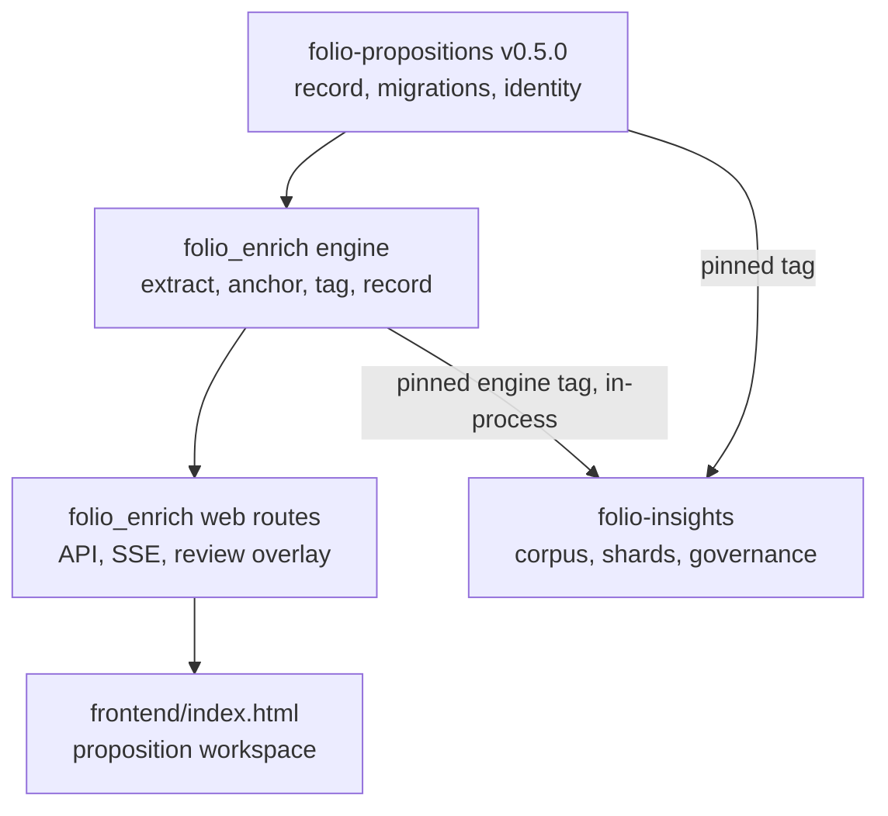
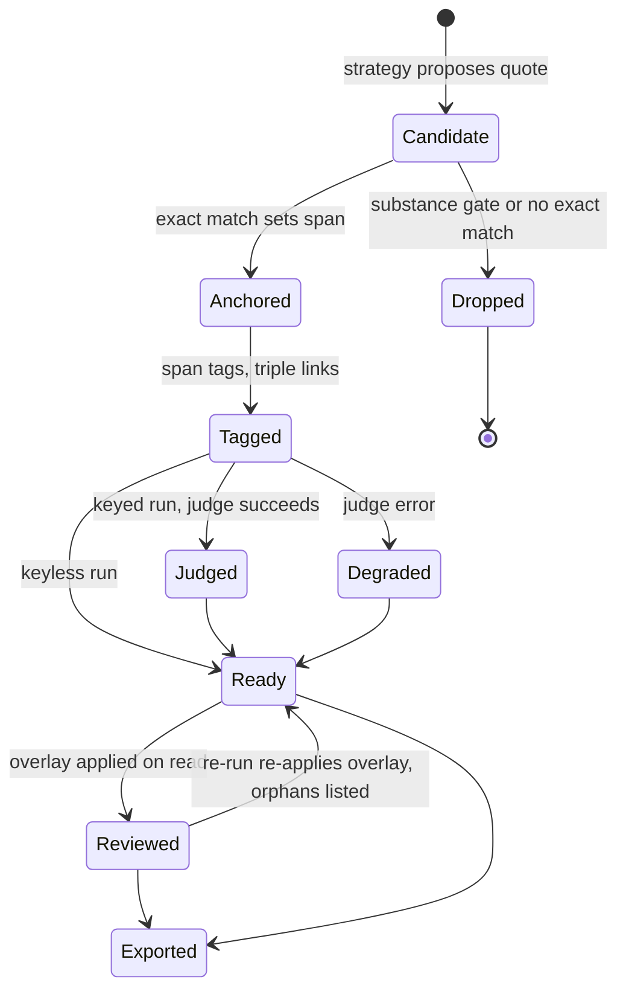
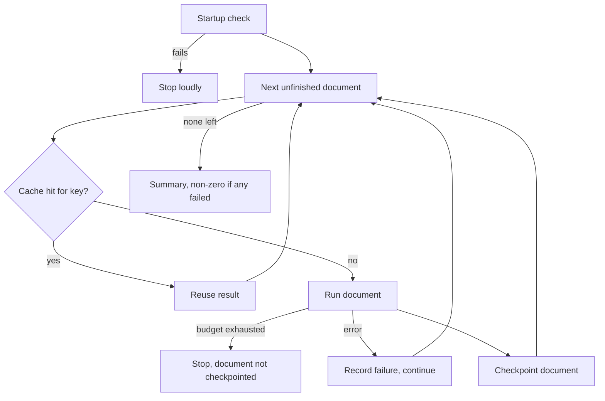

# Unified Proposition Engine - Plan

## Goal Capsule

- **Objective:** One engine turns any legal source, alone or in a corpus of hundreds, into flat, verified, FOLIO-tagged propositions, and both folio-enrich and folio-insights deliver that same output. A fix to extraction or tagging reaches both products at once.
- **Means:** Merge the two proposition models into one record in folio-propositions, make folio-enrich's per-document pipeline that engine, and package it so folio-insights runs it in-process for every document (KTD1, KTD8, KTD9).
- **Product authority:** Damien, inline on 2026-10-25 and 2026-10-26, recorded through Cockpit asks `folio-enrich-2026-10-25-2017-insights-into-enrich-scope` (`focus-slice`), `folio-enrich-2026-10-25-2022-insights-propositions-combine` (`combine-shape`), and `folio-enrich-2026-10-25-2046-insights-single-doc-surface` (`insights-single-doc-surface`). This plan supersedes the 2026-08-16 document/corpus boundary in `docs/plans/2026-08-16-2234-feat-proposition-system-phase-a-plan.md`, which assigned insights its own per-document extraction.
- **Active scope:** the shared record (folio-propositions), the engine and its per-document product surface (folio-enrich), and the engine's packaging for folio-insights. Rewiring folio-insights to consume the engine is a separate follow-on plan in that repo.
- **Target repos:** folio-enrich (home of this plan) for U2–U11; folio-propositions for U1. Paths are repo-relative to the unit's target repo.
- **Execution profile:** implementation goes to workers per the cockpit worker policy; the orchestrating session plans, reviews, verifies, merges, and deploys. One branch per unit or tight unit group, each landed by PR.
- **Stop conditions:**
  - Any U9 benchmark run that would bill an API key stops until Damien approves its spend (a spend hard block). On 2026-10-26 Damien chose to run the LLM tiers through his Claude Max and ChatGPT subscriptions instead, so the planned runs spend nothing.
  - Any change that alters flag-off exports or SSE output without a deliberate, reviewed baseline regeneration stops.
  - Any path where a model writes an IRI stops (R7).
  - Any change that breaks the existing server start command (`uvicorn app.main:app`) used by DEV and PROD deploys stops.
- **Open blockers:** none.

---

## Product Contract

**Product Contract preservation:** restructured, no scope change. R2 now names the explicit status for tags that resolve to no IRI. R15 states that edits survive re-processing (previously "persist on the record"; the storage mechanism moved to KTD5). R16 says every export format instead of "all 13", since `main` now registers 15 (the two shared-schema proposition formats arrived in #44). AE4 added under R15. R13 and AE2 corrected in review (2026-10-26): R13's cache reuse now also requires matching settings, as R12 already did, and AE2's keyless example drops Notice, which no FOLIO label matches in "shall notify". Problem Frame and Dependencies corrected to `main` as of `8ce29a7`. The three deferred questions are resolved in KTD5, KTD7, and KTD8.

### Summary

folio-propositions gains one proposition record that carries the best of both current models. folio-enrich becomes the single per-document engine: it extracts, verifies, tags, reviews, and exports those propositions. folio-insights runs that engine as a pinned library on every document and keeps the cross-document work on top.

### Problem Frame

Two proposition extractors, two proposition models, and two review surfaces exist today, and each holds half of what the product needs.

- **folio-insights' `KnowledgeUnit`** carries a verbatim source snippet, an anchor check, flat multi-branch FOLIO tags, and lineage, but no asserter, validator, disposition, or citation edges.
- **folio-propositions' `Proposition`**, which folio-enrich emits, carries that attribution ledger plus triples and an axiom lifecycle, but no FOLIO tags and no verbatim-anchor check.
- **The bridge:** folio-insights' `bridge_ingest` translates between the two, which exists only because of the duplication.

The folio-insights README, rewritten on 2026-10-25 (folio-insights PRs #48 and #49), now promises flat, span-grounded propositions tagged across FOLIO branches, Deontic Specification included. Neither tool delivers that end to end. Neither extractor has proven quality either: folio-enrich's Phase B lexicon (`phase-b-v1`, `backend/eval/reports/propositions/phase-b-v1.json`) matches 53 of Palsgraf's 104 gold propositions (F1 0.50), up from 7.7% recall in August, and in July a folio-insights treatise run invented units and pointed about 90% of 2,226 tags at the wrong concept. As long as two engines exist, any quality gain lands in one product and not the other.

### Key Decisions

- **One record, carved from both models.** folio-propositions holds the single proposition record, and `KnowledgeUnit` is deprecated. (session-settled: user-directed — chosen over folding all of folio-insights into folio-enrich, making folio-insights the home, or keeping both models with only a shared core: one model with each tool split by job keeps reuse without duplicate products.) Governs R1, R2, R3.
- **folio-enrich's pipeline is the only per-document engine.** folio-insights retires its own extractor and runs this engine on every document, whether a run holds one or hundreds. (session-settled: user-directed — chosen over insights keeping a separate extractor for corpus runs: Damien wants enrich's precision and recall inside insights regardless of document count.) Governs R11, R12, R13.
- **folio-insights also converts single documents.** A single document is a corpus of one, so insights needs no separate single-document mode. (session-settled: user-directed — Damien added this to the split-by-job option.) Governs R12.
- **folio-insights' per-document view shows propositions and what they cite.** (session-settled: user-approved — chosen over showing everything folio-enrich shows, or bare propositions: it keeps the products distinct on one engine.) Governs R14.
- **In-process library, not a network service.** folio-insights imports the pinned engine rather than calling a running folio-enrich. This completes the August bridge-to-library migration and keeps the insights CLI and offline runs working. Governs R11.
- **Measure before choosing the extractor.** The engine's extraction strategy is chosen by score against the gold sets, not by which repo it came from. Governs R8, R9.
- **"Proposition" names the record; "insight" stays a product word.** Code and data use proposition. The folio-insights README keeps its "insights (propositions)" phrasing.

### Requirements

**Unified proposition record (folio-propositions)**

- R1. Every proposition carries its character span, its verbatim source quote, and an anchor check recording whether the quote matches the source at that span.
- R2. Every proposition carries a flat list of FOLIO tags, each with IRI, label, top-level branch, confidence, and the path that produced it, with no hierarchy among tags; a tag that resolves to no IRI carries an explicit proposed status instead.
- R3. The record keeps the existing ledger fields (asserter, validator, disposition, citation edges, triple links, axiom status) and adds per-proposition lineage of the stages that produced or changed it.
- R4. Each proposition records the engine version that produced it.
- R5. Records persisted under earlier schema versions migrate forward without loss, as the v1-to-v2 migration already does.

**Per-document engine (folio-enrich)**

- R6. The engine tags each proposition with every FOLIO concept that applies, drawing on the concept annotations inside its span and adding judged tags such as Deontic Specification and Area of Law.
- R7. No model writes an IRI. Labels resolve to IRIs only through the deterministic resolver.
- R8. The engine rejects a proposition whose quote fails the anchor check, rather than emitting it.
- R9. Each candidate extraction strategy (current lexicon-and-dependency, the folio-insights LLM extractor, and a hybrid of the two) is scored against the gold sets, and the engine ships the best scorer.
- R10. Without a user API key the engine still runs and emits propositions with span-derived tags only. Judged tags appear only when the user supplies a key.

**Engine reuse (folio-enrich packaging)**

- R11. folio-insights can install a pinned engine release and run the full per-document pipeline in-process, without a running folio-enrich server and without importing folio-enrich source from a sibling checkout.
- R12. The engine's per-document output is identical whether folio-enrich or folio-insights invoked it, given the same document, engine version, and settings.
- R13. Corpus runs through the engine honor a spend cap, checkpoint after each document so a failed run resumes, and skip documents whose content hash already has a result for the current engine version and settings.

**folio-enrich product surface**

- R14. The proposition workspace shows each proposition's span, verified quote, FOLIO tags grouped by branch, the authorities and entities it cites, and its linked triples. This same per-document view is the one folio-insights adopts.
- R15. A reviewer can accept, edit, or remove a proposition's tags and add a missed tag in the workspace, and those edits persist and survive re-processing of the same document.
- R16. Every export format includes propositions with their spans, quotes, and tags, matching how exports already carry individuals, properties, and triples.

### Acceptance Examples

- AE1. **Covers R1, R8.**
  - **Given:** a model paraphrases a holding and supplies a quote that does not appear in the source.
  - **When:** the engine runs the anchor check.
  - **Then:** the proposition is rejected and never reaches the workspace or an export.
- AE2. **Covers R6, R10.**
  - **Given:** the data-breach statute from the folio-insights README, run once with no key and once with a key.
  - **When:** the proposition "A business that discovers a data breach must notify each affected resident within 45 days" is emitted.
  - **Then:** without a key it carries span-derived tags such as Data Breach; with a key it also carries Obligation and Privacy Law.
- AE3. **Covers R12, R13.**
  - **Given:** a 200-document corpus run in folio-insights that fails at document 120, with one document already processed by folio-enrich at the same engine version.
  - **When:** the run resumes.
  - **Then:** it continues with the unprocessed documents and reuses the cached result (its stamped engine version and settings match) for the already-processed document, and that document's propositions match folio-enrich's output exactly.
- AE4. **Covers R15.**
  - **Given:** a reviewer removed the Notice tag and added Obligation on a proposition, then the same document is submitted again after an engine upgrade.
  - **When:** the new run completes.
  - **Then:** the proposition shows Obligation and not Notice; an edit whose proposition no longer exists is listed as orphaned instead of silently dropped.

### Success Criteria

- The shipped extraction strategy's precision and recall on the gold sets are published with the release. If they fall short of the folio-insights publishing bar (RUB-EXTRACT ≥ 0.80), the README and UI label the output unvalidated, as folio-insights already labels its own.
- A planner for the folio-insights follow-on can retire `KnowledgeUnit` and its extractor, and reduce `bridge_ingest` to accepting the unified record without translation, using only this plan's record and engine contract, without inventing fields.

---

<!-- ce-section: work-relationships -->
## How This Work Fits Together

This plan covers the shared record, the engine, and its folio-enrich surface. The breakdown below is the current understanding, not a committed roadmap.

**Repository roles going forward:**

- **folio-propositions:** the shared vocabulary. It holds the proposition record, the interchange format, and schema migrations, and nothing else. It stays light so both products can pin it.
- **folio-enrich:** the per-document engine and its webapp. It extracts, verifies, tags, reviews, and exports propositions, alongside its existing concepts, individuals, properties, and triples.
- **folio-insights:** the corpus and governance product. It runs the engine on every document, then merges propositions across sources, flags contradictions, groups by task, mints signed shards, runs governance and review lifecycles, and keeps the SHACL-checked store.

**Later and parallel areas:**

- **folio-insights consumption follow-on** (a separate plan in folio-insights). Depends on R1–R5 and R11–R13. It retires `KnowledgeUnit`, the insights extractor, the translation inside `bridge_ingest` (which keeps receiving folio-enrich's push), the `IngestionBridge` sibling checkout (`folio_enrich_path`), and the sibling-checkout install; migrates stored shards to the unified record; adopts the R14 per-document view; adds spaCy to insights' worker image; and passes its metered LLM port into the engine.
- **In-flight folio-insights work.** Most can proceed independently of this plan:
  - **Can proceed independently of this plan:** Phase 13 storage, the U17 envelope and R18 disposition (already in folio-propositions), Phase 11 SHACL hybrid, governance, the shard minter and kernel, Phase 9 design principles, U6 polysemy, and retiring the last sibling bridges.
  - **Shares with this plan, so realign before new build:** Phase 10 pipeline re-plan (`docs/plans/2026-10-05-0308-feat-phase10-pipeline-replan-plan.md` in folio-insights). Its provider port, durable jobs, and spend reporting stay; new extraction logic waits for R9's result and lands in the engine.
  - **Shares with this plan, so realign before new build:** Review UI re-scope (`docs/plans/2026-10-20-1830-feat-review-ui-rescope-plan.md` in folio-insights). The shard page, supersession, governance wizards, and approval queue stay in insights; its span-anchored annotator is the R14/R15 per-document view, built once.
- **Corpus context feeding per-document tagging.** Still to decide.
- **Engine as a network service** for hosted setups. Still to decide.

---

### Scope Boundaries

- **Deferred for later:**
  - **Corpus context:** using a whole corpus to sharpen a single document's tags.
  - **Network service:** running the engine as a service that folio-insights calls.
  - **Viewer redesign:** redesigning the folio-insights viewer beyond retiring its per-document steps.
- **Outside this plan:**
  - **Insights code changes:** any change inside folio-insights, covered by the follow-on plan.
  - **Shard migration:** migrating existing insights shards, which also belongs to the follow-on.
  - **Cross-document features:** contradictions, task grouping, and minting.
- **Considered and not built:**
  - **PyPI publication** of the engine or folio-propositions. Both consumers already pin git tags with direct references; publishing becomes worth it when an outside consumer appears.
  - **A spend cap inside the folio-enrich webapp.** Its runs are single-document and use the user's own key; the cap lives with corpus runs (KTD9). Evidence that would change this: a hosted multi-document mode in the webapp.
  - **Live SSE updates for every tag change.** The workspace refetches once a job completes (U5); per-edit streaming adds no value for a single reviewer.
  - **Reading a schema-5 job with an older engine.** Downgrades stay unsupported, as today; a rollback documents the one-way door instead.
  - **Proposition-level add and delete in the job workspace.** R15 covers tag edits only; the gold annotation tool already adds and discards whole propositions. Revisit if Damien extends R15.
  - **A web-free engine package.** folio-insights already installs fastapi, so the engine ships as one renamed package with its web modules inside (KTD8). Revisit when a consumer cannot install the web stack.
  - **Optimistic concurrency tokens on review edits.** One reviewer per review scope, writes serialized per scope, and tag-keyed entries make lost updates negligible. Revisit for multi-reviewer review.
  - **Updating already-ingested insights shards after a late edit.** Insights ingest is idempotent per shard IRI; the push waits for review when review is required, so edits made before the push arrive. Later edits reaching existing shards belongs to the insights follow-on.

### Deferred to Follow-Up Work

- The folio-insights consumption plan described in How This Work Fits Together.
- Damien's human validation of the AI-annotated Palsgraf gold set, through the DEV validation session. Damien expects no time for it soon (2026-10-26), so nothing waits on it: U9 decides on the README synthetic set plus the AI-annotated Palsgraf record, labels Palsgraf scores as AI-gold, and the benchmark switches to the validated record automatically if one is ever exported.

### Dependencies / Assumptions

- folio-enrich and folio-insights both pin folio-propositions `v0.4.0` (schema 4); folio-propositions `main` sits at v0.4.0. The unified record ships as v0.5.0 (schema 5).
- folio-enrich already stamps `content_iri` on every proposition (`backend/app/services/proposition/source.py`), exports a `PropositionDocumentRecord` through the `propositions` and `propositions-ndjson` formats (`backend/app/services/export/propositions_exporter.py`), and pushes records to folio-insights after a job when configured (`backend/app/services/insights_client.py`, Damien's 2026-10-09 decision). This plan keeps that push; its payload becomes schema 5 with reviewer edits applied, and folio-insights must accept schema 5 before folio-enrich deploys it (U2).
- The Palsgraf gold set (104 annotation rows) and its public-domain source text are committed under `backend/eval/gold/propositions/`. A human-validation session for it is live on DEV with 104 unreviewed items (`docs/plans/2026-10-03-2355-feat-gold-human-validation-plan.md`); `docs/plans/2026-10-26-0725-feat-fast-gold-annotation-plan.md` speeds that review.
- `backend/eval/proposition_benchmark.py` already scores extraction offline (greedy Dice ≥ 0.5 with Wilson intervals); CI runs the backend suite on pull requests (`.github/workflows/tests.yml`).
- The folio-insights README's eight synthetic examples are invented text with expected propositions, so they may be committed as a second gold set.

### Sources / Research

- **Insights model:** `src/folio_insights/models/knowledge_unit.py` in folio-insights defines `KnowledgeUnit`, `Span`, and `ConceptTag`.
- **Shared record:** `src/folio_propositions/models.py`, `interchange.py`, and `identity.py` in folio-propositions define `Proposition`, `PropositionDocumentRecord`, the single-step migration registry, and `content_iri`.
- **Enrich extractor:** `backend/app/services/proposition/extractor.py`, `identity.py`, and `backend/app/pipeline/stages/proposition_stage.py`.
- **Exports:** among the export modules in `backend/app/services/export/`, only `brat_exporter.py` emits propositions today; `backend/tests/test_proposition_byte_neutral.py` pins flag-off output.
- **Bridge:** `src/folio_insights/bridge_ingest/` and `src/folio_insights/services/bridge/ingestion_bridge.py` in folio-insights are the coupling this plan makes retirable.
- **Prior plan:** `docs/plans/2026-08-16-2234-feat-proposition-system-phase-a-plan.md` holds the August boundary and the proposition-system phases.

---

## Planning Contract

### Key Technical Decisions

- KTD1. **Record shape for v0.5.0 / schema 5.** `text` stays the verbatim span slice, so `content_iri` keeps its meaning. New fields:
  - **`statement`:** optional normalized wording, display-only, never used for anchoring or identity.
  - **Anchor:** `anchor_verified` and `anchor_score`, where `None` means "not checked" (all migrated records).
  - **`folio_tags`:** a flat list of tags carrying `iri` (nullable), `label`, `branch`, `confidence`, `path` (span, judged, reviewer), `evidence_text`, optional `source_annotation_id`, and `status` (`resolved`, `proposed`).
  - **`lineage`:** one event shape adopted from folio-insights' `StageEvent` (timestamp defaulted, paired template fields) plus an optional `actor`.
  - **`engine`:** per-proposition name and version; the record-level `generator` carries the same.
  - Consumers that validate through `migrate_record` or folio-insights' `bridge_ingest` refuse a newer schema, so every reader must pin v0.5.0 before any producer emits schema 5 (U2's release prerequisite). Governs R1–R5.
- KTD2. **Content-derived identity.** A proposition's `id` is a uuid5 over `(document_source_uri(canonical_text), start, end, proposition_type)`, always computed from the canonical text whatever `source_uri` a caller supplies; a supplied URI governs only the record's `source_uri` and each `content_iri`. This replaces today's job-scoped id; `content_iri` (already stamped on `main`) stays text-based for shard identity. Existing gold sessions, which key candidates on the old id, keep their stored ids; new sessions use the new ones. Two typed propositions on one span, or repeated text in one document, therefore get distinct ids. Annotation and individual ids stay uuid4 and never enter proposition output except as `source_annotation_id` evidence. Governs R12, R15.
- KTD3. **Strict anchoring inside extraction.** Every strategy proposes a quote; the engine locates it in the canonical text with exact matching on a folded comparison view (whitespace collapsed, typographic quotes and dashes mapped to ASCII, ligatures expanded, line-break hyphens removed) mapped back to canonical offsets, sets the span from the match, and drops the candidate before it is stored or streamed when no match exists. Fuzzy matches are not accepted, because a 0.85 partial ratio still admits paraphrase. A substance gate skips headings, tables of contents, and attribution lines before any LLM extraction runs, since anchoring cannot catch fabrication from a heading (folio-insights `docs/solutions/heading-as-unit-fabrication.md`). Rejections are counted in job metadata. Governs R1, R8.
- KTD4. **A post-parallel tagging stage.** `PropositionTaggingStage` runs after `TripleEnrichmentStage` and before metadata, because concept annotations, individuals, properties, and triples must exist first.
  - **Span tags:** from non-rejected annotation concepts, individual class links, and properties whose spans fall inside the proposition span; each keeps its evidence text and source annotation id.
  - **Triple links:** `triple_ids` filled from triples inside the span.
  - **Judged tags:** Deontic Specification from the closed set of that subtree's children, and Area of Law from that branch's labels, both chosen by an LLM judge and resolved only through `ConceptResolver`; out-of-set labels are dropped.
  - **Failures:** a judge error marks the proposition degraded and keeps its span tags.
  - **Keyless:** with no provider the stage runs span tags only and makes no network call. Judge calls run under a concurrency limit.
  - Governs R6, R7, R10.
- KTD5. **A scoped review overlay outside the job file.** Reviewer edits live in a review store keyed by `(review_scope, canonical source URI, proposition id, tag key)`, separate from job JSON.
  - **Scope:** `review_scope` is an unguessable capability minted at a job's first edit and returned with reads; the workspace remembers it per document, and a resubmission carries it, so identical text submitted by someone else never sees or writes those edits.
  - **Application:** one shared proposition reader applies the overlay for workspace reads, every export, and the insights push (`build_proposition_record`).
  - **Re-runs:** after a re-run, an entry whose proposition id is gone re-attaches to the new proposition of the same type whose span overlaps at Dice ≥ 0.5; only unmatched entries surface as orphaned.
  - **Writes:** refused until the job completes, serialized per review scope, length-limited, and capped per scope.
  - **Retention:** entries expire `job_retention_days` after their last edit unless a gold session or protected job covers the document.
  - **Ownership:** the job plus its overlay owns tags; gold sessions stay a separate gold-set tool.
  - Governs R15.
- KTD6. **Byte-neutral exports.** The two shared-schema formats (`propositions`, `propositions-ndjson`) move to schema 5 unchanged in shape. Every other exporter emits a propositions section only when `job.result.propositions` is non-empty, following the brat precedent, so flag-off output stays byte-identical. Exports read propositions with the overlay applied, omit removed tags, write proposed tags with an empty IRI in tabular formats, and never emit an RDF or Neo4j node for a proposed tag. Governs R16.
- KTD7. **Benchmark design.** Keep `backend/eval/proposition_benchmark.py`'s rule: greedy one-to-one matching at Dice ≥ 0.5, with Wilson intervals; scores are precision, recall, and F1 per gold set and per source type. Gold sets: the eight README synthetic examples, whose expected propositions Damien approved in the README (folio-insights PRs #48 and #49), and Palsgraf (already committed; AI-annotated, so its scores are labeled AI-gold until a validated record exists). Both sets carry heading and attribution adversarial lines. Selection uses F1 over the Palsgraf held-out split pooled with the README set; the development split, which tuned `phase-b-v1`, is reported for reference only. A strategy wins only when its 95% Wilson interval does not overlap the runner-up's; otherwise the cheaper strategy ships, and the held-out split is recorded as consumed. The zero-LLM tier runs free in CI; LLM and hybrid tiers run at no API cost through the subscription CLIs (Damien, 2026-10-26): Claude Code (`claude -p`, Max plan) as the primary row and Codex (`codex exec`, ChatGPT plan) as a second model, each on a pinned model ID. Neither CLI exposes temperature, so each LLM row runs three times and reports its mean and spread. Governs R9.
- KTD8. **Engine packaging.** The top-level package `app` becomes `folio_enrich` (web modules stay inside it), so installing the engine never adds a generic `app` package to a consumer; the package declares every runtime dependency it imports, including a pinned `en_core_web_sm` wheel. The repo keeps a `backend/app/main.py` shim outside the wheel so `uvicorn app.main:app` still starts DEV and PROD. The engine supports Python 3.11–3.13. Releases use `engine-vX.Y.Z` tags, which do not match the `v*` trigger of the desktop build, and consumers pin `git+…@engine-vX.Y.Z#subdirectory=backend`. Governs R11.
- KTD9. **Engine API and corpus runs.** The engine exposes a document entry point and a corpus entry point, both taking an explicit settings snapshot and injected LLM providers.
  - **Settings delivery:** the entry points install the snapshot into a context variable, and the module-level `settings` object becomes a proxy that resolves through it, so existing stage code keeps reading `settings.x` while each call sees its own snapshot. The snapshot carries `require_user_api_key`, so no engine path falls back to a server-held key when it is set.
  - **Cache key:** canonical-text hash, engine version, and a settings fingerprint: a hash of the full serialized snapshot plus the hashes of FOLIO and every enabled ontology, the spaCy model version, the embedding provider and model (or "unavailable"), and LLM model ids or "keyless". The key is stamped on the record generator, so a record produced elsewhere (including a pushed folio-enrich record) with a matching key is a valid cache entry; keyed runs meet R12 by reuse, not re-execution.
  - **Source URIs:** cached results are source-independent; a cache hit re-stamps the caller's `source_uri` and `content_iri`s.
  - **Checkpoints:** written only for fully processed documents; resume works by the set of finished hashes, not position.
  - **Budget:** budget exhaustion is its own exception type, re-raised by the orchestrator's stage isolation, the proposition LLM assist, and the tagging judge ahead of their generic error handling. It stops the corpus cleanly, leaves the current document without a checkpoint or cache entry, and never falls back to keyless.
  - **Failures:** a failed document is recorded and the run continues, ending with a non-zero summary.
  - **Startup check:** the engine verifies FOLIO labels, the resolver, and the spaCy model at startup and fails loudly, carrying folio-insights' bridge-staleness lesson (`docs/solutions/sys-path-bridge-staleness.md` there).
  - Governs R11, R12, R13.
- KTD10. **Engine version.** The engine version is the engine release number, declared once and checked against the `engine-vX.Y.Z` tag at release, plus a short hash over engine-core source (extraction, anchoring, tagging, judge), prompts, lexicons, and label sets, so any extraction change invalidates caches without a manual bump. Governs R4, R13.

### High-Level Technical Design

Package and data relationships after this plan:

Proposition lifecycle within one document run and its re-runs:

Corpus run flow (KTD9):

Run modes:

| Mode | Extraction | Span tags | Judged tags | Network |
|---|---|---|---|---|
| Flag off | none | none | none | unchanged from today |
| Flag on, keyless | zero-LLM strategy | yes | no | none for propositions |
| Flag on, keyed | shipped strategy (U9) | yes | yes, or degraded | user's provider |
| Corpus, keyed, budget hit | stops at boundary | n/a | n/a | stops; never falls back to keyless |

### Assumptions

- Enrich's code uses no syntax newer than Python 3.11; U10 verifies this with a 3.11 test run.
- A uuid5 proposition id change is acceptable for existing jobs; migrated jobs keep their stored ids, and only new runs use KTD2 ids.
- Subscription rate limits (Claude Max's five-hour and weekly windows; the Codex weekly allotment the worker fleet shares) may delay the LLM rows. The run covers two small gold sets and resumes per document; until a measured winner lands, the engine ships `phase-b-v1` lexicon extraction, and a later engine release carries the winner.

### Risks

| Risk | Mitigation |
|---|---|
| The package rename breaks DEV or PROD deploys | Repo shim keeps `uvicorn app.main:app`; U10 smoke-starts the server from the shim and from both Dockerfiles |
| A schema-5 push reaches a folio-insights still on v0.4.0 and is refused | U2's release prerequisite: the folio-insights pin moves to v0.5.0 before any folio-enrich deploy that emits schema 5 |
| Ontology or settings drift makes enrich and insights tag differently | The KTD9 fingerprint covers the full settings snapshot and every ontology hash, so drift shows as a cache miss and a visible version difference |
| Benchmark overfits one opinion | Second gold set from the README's eight source types and a held-out selection rule (KTD7) |
| Proposed tags skew downstream votes | Explicit `proposed` status (KTD1); the engine contract tells consumers to exclude proposed tags from votes |
| Schema 5 jobs are unreadable after a rollback | Documented one-way door in the release notes; `JobStore.list_jobs` logs skipped ids instead of hiding them |
| Book-length sources exhaust a corpus budget on one document | Budget exhaustion stops cleanly without caching (KTD9); the insights follow-on sizes budgets from U9's per-document token counts |

---

## Implementation Units

| U-ID | Title | Key files | Depends on |
|---|---|---|---|
| U1 | Unified record v0.5.0 | folio-propositions `src/folio_propositions/models.py`, `interchange.py` | — |
| U2 | Adopt schema 5 and content identity | `backend/app/models/job.py`, `backend/app/services/proposition/identity.py`, `backend/app/services/proposition/source.py` | U1 |
| U3 | Anchored extraction | `backend/app/services/proposition/`, `backend/app/pipeline/stages/proposition_stage.py` | U2 |
| U4 | Proposition tagging stage | `backend/app/pipeline/stages/proposition_tagging_stage.py`, `backend/app/pipeline/orchestrator.py` | U2 |
| U5 | Review overlay and edit routes | `backend/app/storage/review_store.py`, `backend/app/api/routes/propositions.py`, `backend/app/services/post_job/flow.py` | U4 |
| U6 | Workspace tags and citations | `frontend/index.html` | U5, fast gold annotation plan |
| U7 | Propositions in all exports | `backend/app/services/export/*` | U5 |
| U8 | Benchmark gold sets | `backend/eval/proposition_benchmark.py`, `backend/eval/gold/propositions/` | U2 |
| U9 | Extractor bake-off | `backend/app/services/proposition/strategies/`, `backend/eval/proposition_benchmark.py` | U3, U8 |
| U10 | Engine package rename | `backend/pyproject.toml`, `backend/folio_enrich/`, `backend/app/main.py` | U3–U8, U9 steps 1–3 |
| U11 | Engine API, corpus runs, contract | `backend/folio_enrich/engine.py`, `.github/workflows/engine-smoke.yml`, `docs/engine-contract.md` | U10 |

### U1. Unified record v0.5.0

- **Goal:** folio-propositions v0.5.0 carries the unified record with a lossless v4→v5 migration.
- **Requirements:** R1–R5; KTD1, KTD2.
- **Dependencies:** none.
- **Target repo:** folio-propositions.
- **Files:** `src/folio_propositions/models.py`, `src/folio_propositions/interchange.py`, `src/folio_propositions/identity.py`, `src/folio_propositions/__init__.py`, `pyproject.toml`, `docs/migration-0.5.0.md`, `docs/README.md`, `tests/test_models.py`, `tests/test_interchange.py`, `tests/test_identity.py`.
- **Approach:**
  1. Add the KTD1 tag, lineage, anchor, statement, and engine fields with defaults that keep v4 payloads valid.
  2. Add a proposition-id helper implementing KTD2 next to `content_iri`.
  3. Register a single-step `_migrate_v4_to_v5` following `_migrate_v3_to_v4`: empty tags and lineage, anchor `None`, no engine.
  4. Bump `SCHEMA_VERSION` to 5 and `__version__` to 0.5.0; write the migration doc, including the reader-first upgrade rule; tag `v0.5.0` after merge.
- **Patterns to follow:** `_migrate_v3_to_v4` and its tests; the v0.4.0 release doc and annotated tag.
- **Test scenarios:**
  - A v4 record with two propositions migrates to v5 with empty `folio_tags`, empty `lineage`, and `anchor_verified` `None`.
  - A v3 Palsgraf gold proposition dict migrates through v4 to v5 unchanged in every existing field.
  - A tag with `status` `proposed` and `iri` `None` validates; a `resolved` tag with no IRI is rejected.
  - The proposition-id helper returns different ids for two types on one span, and for the same text at two offsets.
  - `migrate_record` refuses a v6 payload.
- **Verification:** the folio-propositions suite, ruff, and mypy pass on 3.11–3.13 in its CI; the `v0.5.0` tag exists.

### U2. Adopt schema 5 and content identity

- **Goal:** folio-enrich pins v0.5.0, builds content-derived ids, and stamps engine version on every proposition and record, without breaking the insights push.
- **Requirements:** R4, R5, R12; KTD1, KTD2, KTD10.
- **Dependencies:** U1.
- **Release prerequisite:** a pin-only folio-insights change (folio-propositions v0.4.0 → v0.5.0, no other code) merges and deploys before any folio-enrich deploy carrying this unit. It is the first step of the insights follow-on and is filed there.
- **Files:** `backend/pyproject.toml`, `backend/uv.lock`, `backend/app/models/job.py`, `backend/app/services/proposition/identity.py`, `backend/app/services/proposition/source.py`, `backend/app/services/proposition/extractor.py`, `backend/app/services/export/propositions_exporter.py`, `backend/app/services/insights_client.py`, `backend/app/engine_version.py` (new), `backend/app/storage/job_store.py`, `backend/app/services/gold/store.py`, `backend/tests/fixtures/proposition_baseline/export.propositions`, `backend/tests/fixtures/proposition_baseline/export.propositions-ndjson`, `backend/tests/test_proposition_identity.py` (new), `backend/tests/test_proposition_stage.py`, `backend/tests/test_gold_store.py`.
- **Approach:**
  1. Move the pin from `v0.4.0` to `v0.5.0`; existing `migrate_record` loading carries v3 and v4 jobs and gold rows to v5.
  2. Compute new proposition ids per KTD2 from the canonical-text URI; keep a caller-supplied `source_uri` for the record and `content_iri` only; leave stored gold-session ids untouched.
  3. Compute the KTD10 engine version once per process and stamp it on each proposition and on the record generator that the `propositions` exporter and the insights push build.
  4. Regenerate exactly the `propositions` and `propositions-ndjson` flag-off fixtures (schema 4 → 5) in one reviewed commit.
  5. Make `list_jobs` log job ids it skips because of a schema error.
- **Patterns to follow:** the `migrate_persisted_propositions` validator in `backend/app/models/job.py`; `stamp_content_iris` in folio-propositions.
- **Test scenarios:**
  - The same document text run as two jobs yields identical proposition ids.
  - The same text with and without a caller-supplied `source_uri` yields identical proposition ids and different `content_iri`s.
  - A stored schema-4 job file loads with propositions at schema 5 and `anchor_verified` `None`.
  - An existing gold session still resolves every candidate by its stored id after the upgrade.
  - The `propositions` export and the insights push payload validate as schema-5 `PropositionDocumentRecord`s, including the `content_iri` check.
  - Editing a lexicon entry or an extractor module changes the engine version; editing a web-route module does not.
  - A job file with a newer schema is skipped by `list_jobs` and logged.
- **Verification:** the backend suite passes; the byte-neutral test passes with only the two proposition fixtures regenerated.

### U3. Anchored extraction

- **Goal:** every emitted proposition carries a verified verbatim quote, and unanchored candidates never reach storage or SSE.
- **Requirements:** R1, R8; KTD3. Covers AE1.
- **Dependencies:** U2.
- **Files:** `backend/app/services/proposition/anchoring.py` (new), `backend/app/services/proposition/substance.py` (new), `backend/app/services/proposition/extractor.py`, `backend/app/pipeline/stages/proposition_stage.py`, `backend/app/services/llm/prompts/templates.py`, `backend/tests/test_proposition_anchoring.py` (new), `backend/tests/test_proposition_stage.py`.
- **Approach:**
  1. Add the KTD3 locator: exact match on the folded comparison view, with an offset map back to canonical text, returning the span or no match.
  2. Change the LLM assist prompt to return quotes instead of offsets, and route its candidates through the locator.
  3. Run lexicon candidates through the locator too, so every proposition carries an anchor result.
  4. Add the substance gate before LLM extraction; count gated and rejected candidates in job metadata.
- **Patterns to follow:** `EarlyPropositionStage._assist` validation and merge; `_build` slicing text from offsets.
- **Test scenarios:**
  - Covers AE1. An LLM candidate whose quote is absent from the text is dropped, never stored, and counted as rejected.
  - A quote differing only in line breaks and double spaces anchors to the right span.
  - A quote with straight apostrophes anchors against curly ones in the source, and "negligence" anchors against "negli-\ngence".
  - A paraphrased quote that differs by one content word is rejected.
  - A quote that occurs twice anchors to the occurrence in the sentence the strategy named, else the first.
  - A heading line such as "II. DISCUSSION" never reaches the LLM and is counted as gated.
  - Lexicon output gets `anchor_verified` true and `anchor_score` 1.0.
  - An SSE stream for a job with a rejected candidate emits no `proposition_added` for it.
- **Verification:** the proposition tests pass; the byte-neutral test still passes with the flag off.

### U4. Proposition tagging stage

- **Goal:** each proposition carries flat FOLIO tags from its span plus judged Deontic and Area of Law tags when keyed.
- **Requirements:** R2, R6, R7, R10, R14 (data); KTD4, KTD9 (budget exception). Covers AE2.
- **Dependencies:** U2.
- **Files:** `backend/app/pipeline/stages/proposition_tagging_stage.py` (new), `backend/app/services/proposition/tagging.py` (new), `backend/app/services/proposition/judge.py` (new), `backend/app/pipeline/orchestrator.py`, `backend/app/services/llm/prompts/templates.py`, `backend/tests/test_proposition_tagging.py` (new).
- **Approach:**
  1. Build span tags from non-rejected annotation concepts, individual class links, and properties contained in the proposition span; map `ConceptMatch.branches[0]` to the flat branch.
  2. Fill `triple_ids` from triples inside the span.
  3. Build the closed Deontic and Area of Law label sets from the loaded FOLIO ontology; the judge picks labels from them, and `ConceptResolver` resolves each to an IRI or the tag becomes `proposed`.
  4. Add the stage to both `build_stages` and `build_pipeline_config`, after `TripleEnrichmentStage`; judged tagging runs only when a proposition provider resolves through the existing `require_user_api_key`-aware path.
  5. Bound judge calls with a semaphore; record degraded propositions and rejected labels in metadata; let the budget exception propagate.
- **Patterns to follow:** `BranchJudgeStage` and its conditional inclusion; `ConceptResolver.resolve`; the per-task LLM wiring for `"proposition"` in `TaskLLMs`.
- **Test scenarios:**
  - Covers AE2. Keyless run on the synthetic data-breach statute: the proposition carries Data Breach with `path` span and no Obligation; every keyless tag's label or lemma occurs in the span.
  - Covers AE2. Keyed run with a stub judge returning "Obligation" and "Privacy Law": both tags resolve to their IRIs with `path` judged.
  - A judge returning "Very Obligatory" (out of set) produces no tag and increments the rejected-label count.
  - A judge timeout leaves span tags intact and marks the proposition degraded.
  - A judge raising the budget exception stops the job instead of marking it degraded.
  - With `require_user_api_key` true, a server key configured, and no request key, the stage makes no LLM call.
  - A rejected annotation inside the span contributes no tag.
  - A triple inside the span appears in `triple_ids`; one outside does not.
  - A keyless run performs no LLM call (the stub provider records zero calls).
  - An in-set label the resolver cannot map is stored as `proposed` with no IRI.
- **Verification:** tagging tests pass; a flag-off pipeline run still matches the byte-neutral baseline.

### U5. Review overlay and edit routes

- **Goal:** reviewer tag edits persist in a scoped overlay, apply to every read, export, and push, and survive re-runs.
- **Requirements:** R15; KTD5. Covers AE4.
- **Dependencies:** U4.
- **Files:** `backend/app/storage/review_store.py` (new), `backend/app/services/proposition/overlay.py` (new), `backend/app/api/routes/propositions.py` (new), `backend/app/main.py`, `backend/app/services/export/propositions_exporter.py`, `backend/app/services/post_job/flow.py`, `backend/app/storage/job_store.py`, `backend/app/services/streaming/sse.py`, `backend/tests/test_review_overlay.py` (new), `backend/tests/test_proposition_routes.py` (new).
- **Approach:**
  1. Add a filesystem review store with atomic writes under the jobs root, keyed per KTD5, with its own expiry sweep run beside `cleanup_expired`.
  2. Add routes to read propositions with the overlay applied (returning the review scope) and to accept, remove, restore, and add tags. Add-tag takes a FOLIO label or an IRI already loaded in the ontology; the server resolves it through `ConceptResolver` and refuses anything else.
  3. Gate writes on completed jobs, serialize them per review scope, enforce length and count caps, and append a lineage event with `actor` user per edit.
  4. Apply the overlay inside the shared proposition reader used by `build_proposition_record`, so the post-job insights push carries reviewed tags.
  5. Re-apply the overlay after a re-run per KTD5, re-attaching by Dice ≥ 0.5 overlap and listing the rest as orphaned; allow dismissing an orphan.
  6. Add `total_propositions` to the SSE `complete` event only when the job has propositions.
- **Patterns to follow:** the promote, reject, and restore routes in `backend/app/api/routes/enrich.py`; `JobStore` atomic writes.
- **Test scenarios:**
  - Covers AE4. Remove Notice, add Obligation, re-run the same text with the review scope: the read shows Obligation and not Notice.
  - Covers AE4. A re-run whose span boundaries shift by a few words still applies the edit; an edit with no overlapping proposition appears in the orphan list.
  - A second job on identical text without the review scope sees no overlay and cannot write to it.
  - An add-tag request carrying an IRI outside the loaded ontology is refused, and nothing is stored.
  - An edit sent while the job is running returns 409 and changes nothing.
  - A push after completed review carries the reviewer's removed and added tags.
  - An overlay idle beyond `job_retention_days` is removed by the sweep; a write past the cap is refused.
  - The flag-off SSE `complete` event matches the baseline; a job with propositions reports the count.
- **Verification:** route and overlay tests pass; existing annotation route tests and the byte-neutral test pass unchanged.

### U6. Workspace tags and citations

- **Goal:** the proposition workspace shows R14's per-document view and lets a reviewer edit tags through U5.
- **Requirements:** R14, R15.
- **Dependencies:** U5; `docs/plans/2026-10-26-0725-feat-fast-gold-annotation-plan.md` lands first, and U6 reuses its save queue, undo, and shortcut conventions.
- **Files:** `frontend/index.html`.
- **Approach:**
  1. Render quote, statement, tags, citations, and triples from the U5 read route, keyed by proposition id; gold-session records supply only outcome fields. Sessions created before KTD2 ids show their tag area read-only.
  2. In `renderPropositionCard`, order the card as quote and statement, then tags grouped by branch (largest branches first, groups past three collapsed), then cited authorities and entities, then linked triples, then the existing form fields, with review actions pinned in view.
  3. Show distinct tag-area states: "Judged tags need your API key" (keyless), "Tag judging failed; span tags shown" (degraded), "Not tagged (processed before tagging)" (migrated), "No tags found", and a loading state during refetch; migrated quotes show "quote not checked".
  4. Add remove and restore controls (a "Removed (n)" disclosure) and an add-tag combobox that searches FOLIO labels through the existing concept search, filters by branch, and adds only resolved concepts. Tag edits save immediately, independent of the proposition's outcome buttons, through the fast-annotation save queue.
  5. Show a document-level "Orphaned edits (n)" section with dismiss controls.
  6. Refetch propositions on the SSE `complete` event without re-rendering a card that has unsaved changes; offer a reload banner instead.
  7. Mark proposed tags with the word "Proposed" and a dashed outline, not color alone; give each tag control an accessible name that includes the tag label, 44 px touch targets, and status announcements.
- **Patterns to follow:** the existing proposition review workspace CSS and JS blocks; branch colors and pills from the multi-branch span tooltip.
- **Test expectation:** UI behavior verified in a real browser (Playwright, per the repo's browser-testing rule): a keyed demo job renders grouped tags, a tag removal persists across reload and can be restored, the add-tag combobox adds a resolved label by keyboard, a keyless job shows the API-key state, and a running job's edit shows the not-ready message. Screenshots inspected and deleted.
- **Verification:** the browser checks above pass on desktop and phone widths, with keyboard-reachable controls and visible focus.

### U7. Propositions in all exports

- **Goal:** every exporter includes propositions with spans, quotes, and tags when a job has them, and stays byte-identical when it does not.
- **Requirements:** R16; KTD6.
- **Dependencies:** U5.
- **Files:** `backend/app/services/export/json_exporter.py`, `jsonld_exporter.py`, `xml_exporter.py`, `csv_exporter.py`, `jsonl_exporter.py`, `parquet_exporter.py`, `elasticsearch_exporter.py`, `neo4j_exporter.py`, `rag_exporter.py`, `rdf_exporter.py`, `brat_exporter.py`, `html_exporter.py`, `excel_exporter.py`, `propositions_exporter.py`, `backend/tests/test_proposition_exports.py` (new), `backend/tests/fixtures/proposition_exports/` (new).
- **Approach:**
  1. Read propositions through U5's shared reader, so every format sees the overlay.
  2. Add a guarded propositions section to each exporter, mirroring its triples section.
  3. Apply KTD6's rules for removed and proposed tags in every format.
- **Patterns to follow:** each exporter's `if job.result.triples:` section; brat's propositions-only-when-present rule.
- **Test scenarios:**
  - A flag-off job exports byte-identically to the existing baseline in every pinned format.
  - A job with one resolved and one proposed tag exports both in JSON and CSV, the proposed one with an empty IRI.
  - RDF and Neo4j exports contain no node for the proposed tag.
  - A tag removed through the overlay appears in no export.
  - Golden fixtures per format match for a two-proposition job.
- **Verification:** export tests and the byte-neutral test pass.

### U8. Benchmark gold sets

- **Goal:** the existing deterministic benchmark measures any extraction strategy against Palsgraf and a new README synthetic set.
- **Requirements:** R9; KTD7.
- **Dependencies:** U2.
- **Files:** `backend/eval/proposition_benchmark.py`, `backend/eval/gold/propositions/readme-synthetic.jsonl` (new), `backend/eval/gold/propositions/readme-synthetic/` (new source texts), `backend/eval/gold/propositions/manifest.json`, `backend/eval/gold/propositions/README.md`, `backend/tests/test_proposition_benchmark.py`.
- **Approach:**
  1. Encode the README's eight synthetic excerpts and their expected propositions as a gold record, plus heading and attribution adversarial lines marked as must-not-extract.
  2. Extend the benchmark to score any strategy (not only the lexicon), report per gold set, per split, and per source type, apply KTD7's selection rule, and prefer a `-validated` record over its AI original when both exist.
- **Patterns to follow:** the existing benchmark's matching and report layout; the `eval` marker and long timeout from `docs/solutions/2026-07-07-ner-eval-gold-set-harness.md`.
- **Test scenarios:**
  - Every synthetic gold span slices its committed text to its stored `text`.
  - A stub strategy returning fixed spans is scored with the same Dice rule as the lexicon.
  - An extracted adversarial heading counts as a false positive.
  - Two strategies with overlapping Wilson intervals select the cheaper one.
  - With both `palsgraf-248-ny-339` and `palsgraf-248-ny-339-validated` present, the benchmark scores the validated one.
- **Verification:** scorer tests pass in the default suite; the deterministic scoring run executes under the `eval` marker.

### U9. Extractor bake-off

- **Goal:** the engine ships the extraction strategy chosen by measurement.
- **Requirements:** R9, Success Criteria; KTD3, KTD7.
- **Dependencies:** U3, U8.
- **Files:** `backend/app/services/proposition/strategies/__init__.py` (new), `strategies/lexicon.py` (new, wraps today's `phase-b-v1` extractor), `strategies/llm.py` (new, ports folio-insights' boundary and distill prompts), `strategies/hybrid.py` (new), `backend/eval/proposition_benchmark.py`, `backend/eval/subscription_llm.py` (new, eval-only providers that call the `claude` and `codex` CLIs), `backend/eval/reports/propositions/` (new report), `backend/app/config.py`, `backend/tests/test_proposition_strategies.py` (new).
- **Approach:**
  1. Put the three strategies behind one interface; all three propose quotes and pass through U3 anchoring. The hybrid merges a lexicon and an LLM candidate of the same type overlapping at Dice ≥ 0.5 into one proposition, keeping the LLM span.
  2. Port folio-insights' LLM extraction prompts, keeping its distilled wording only as `statement`.
  3. Score the lexicon strategy and commit that report.
  4. Run the LLM and hybrid strategies through the eval-only subscription providers, three runs each, then add the results and per-strategy anchor-rejection rates to the report. Set the default strategy to the KTD7 winner, and keep lexicon as the keyless strategy.
     - **Claude row:** `claude -p` with a pinned Sonnet model ID, `--tools ""`, `--setting-sources ""`, `--strict-mcp-config`, `--no-session-persistence`, `--output-format json`, and `--json-schema`. The child environment drops `ANTHROPIC_API_KEY` and `ANTHROPIC_BASE_URL`, so the call always bills the Max login, never a key.
     - **Codex row:** `codex exec` with a pinned Sol model, `--ephemeral`, `--skip-git-repo-check`, `-s read-only`, `--output-schema`, and `-o`, with stdin closed. Without closed stdin, `codex exec` waits for input and hangs.
     - **Boundary:** these providers live under `backend/eval/` only, never in the webapp's provider registry. The deployed engine serves users with their own keys, and Damien's subscriptions never back a hosted request.
     - **Smoke test (2026-10-26):** both CLIs returned schema-valid verbatim quotes from a Palsgraf passage, in 6 seconds (Claude) and 12 seconds (Codex).
  5. Record the scores and the unvalidated label decision against the RUB-EXTRACT bar in the report and README.
- **Execution note:** a worker builds steps 1–3 and the providers. Step 4 needs the home box's logged-in CLIs and network, which sandboxed workers lack, so the orchestrating session runs the benchmark command itself. A rate-limit delay may push step 4 past `engine-v0.1.0` into a later engine release.
- **Patterns to follow:** `backend/eval/proposition_benchmark.py` and its `phase-b-v1` report; `PINNED_FLAGS` in `backend/eval/synthetic_runner.py`.
- **Test scenarios:**
  - Each strategy, given a stub LLM returning fixed quotes, yields anchored propositions only.
  - The hybrid merges an overlapping lexicon and LLM candidate into one proposition with the LLM span.
  - The subscription providers strip API-key variables from the child environment, fail clearly when a CLI is missing or logged out, and parse schema output; no module under `backend/app/` imports them.
  - The runner refuses an API-key LLM provider without an explicit approved-spend flag.
  - The keyless config always selects the lexicon strategy.
- **Verification:** strategy tests pass; the committed report lists lexicon precision, recall, and F1 on both gold sets, and LLM and hybrid rows from both subscription models.

### U10. Engine package rename

- **Goal:** folio-insights can install folio-enrich as a namespaced package without a generic `app` package, while the webapp and deploys keep running.
- **Requirements:** R11; KTD8.
- **Dependencies:** U3–U8 and U9 steps 1–3.
- **Files:** `backend/folio_enrich/` (renamed from `backend/app/`), `backend/app/main.py` (shim, outside the wheel), `backend/pyproject.toml`, `Dockerfile`, `backend/Dockerfile`, `.github/workflows/build.yml`, `.github/workflows/tests.yml`, `backend/tests/` (import updates), `CLAUDE.md`.
- **Approach:**
  1. Rename the package and update every import mechanically.
  2. Declare every runtime dependency, including the pinned `en_core_web_sm` wheel; the wheel packages only `folio_enrich`.
  3. Keep `uvicorn app.main:app` working through the shim; update both Dockerfiles and the PyInstaller hidden imports.
  4. Add a Python 3.11 run of the backend suite to CI.
- **Execution note:** mostly packaging; prove it with install and start smoke checks rather than new unit tests.
- **Patterns to follow:** the lazy-import packaging lesson in cockpit `docs/solutions/2026-07-07-book-indexer-oss-extraction.md`.
- **Test scenarios:**
  - A fresh environment installs the package and imports `folio_enrich` with no `app` package present.
  - The server starts through `app.main:app` and through `folio_enrich.main:app`, and `/health` answers.
  - The full backend suite passes on Python 3.11 and 3.13.
- **Verification:** the suite passes; both Dockerfiles build and serve `/health`.

### U11. Engine API, corpus runs, and contract

- **Goal:** folio-insights can call one documented engine API for single documents and corpora, with caching, resume, budget stops, and a loud startup check.
- **Requirements:** R11, R12, R13; KTD9, KTD10. Covers AE3.
- **Dependencies:** U10.
- **Files:** `backend/folio_enrich/engine.py` (new), `backend/folio_enrich/corpus.py` (new), `backend/folio_enrich/canary.py` (new), `backend/folio_enrich/config.py`, `backend/folio_enrich/pipeline/orchestrator.py`, `backend/folio_enrich/pipeline/stages/proposition_stage.py`, `backend/tests/test_engine_api.py` (new), `backend/tests/test_corpus_runs.py` (new), `.github/workflows/engine-smoke.yml` (new), `docs/engine-contract.md` (new), `README.md`.
- **Approach:**
  1. Make `settings` a context-variable proxy per KTD9 and add the document entry point, which takes text or a file, a settings snapshot, and providers, and returns the `PropositionDocumentRecord` (cache key stamped on the generator) plus run metadata.
  2. Add the budget exception type and re-raise it ahead of the generic handlers in the orchestrator's stage isolation and the proposition LLM assist.
  3. Add the corpus entry point implementing KTD9's cache, re-stamping, checkpoints, hash-set resume, budget stop, and failure summary; accept prior records with a matching stamped key as cache hits.
  4. Add the startup check and call it from both entry points.
  5. Add a CI workflow that installs the engine in a fresh environment on 3.11 and 3.12 and runs one synthetic document end to end; add a release check that the `engine-vX.Y.Z` tag matches the declared engine release.
  6. Write `docs/engine-contract.md` for the folio-insights follow-on: entry points, record fields, proposed-tag voting rule, cache key and reuse rule, budget behavior, reader-first schema upgrades, version and tag scheme.
  7. Tag `engine-v0.1.0` after merge.
- **Patterns to follow:** `PipelineOrchestrator(JobStore(base_dir=...))` with explicit `llm=` from the gold-set harness lesson; folio-insights' `CostMeter` budget exception as the provider contract.
- **Test scenarios:**
  - Covers AE3. A 5-document corpus whose provider raises the budget exception on document 3 stops; the resumed run processes only documents 3–5.
  - Covers AE3. A record produced earlier by the document entry point, including one round-tripped through the insights push payload, is reused as a cache hit when its stamped key matches.
  - A cache hit under a different caller `source_uri` returns identical proposition ids with that caller's `content_iri`s.
  - Changing a pipeline threshold, `enabled_ontologies`, the ontology hash, the LLM model id, the keyless flag, or the engine version each produces a cache miss.
  - A budget exception raised inside a post-parallel LLM stage stops the run with no checkpoint, no cache entry, and no keyless retry.
  - A corpus with one ordinarily failing document finishes the rest and returns a non-zero summary.
  - Two concurrent documents under different settings snapshots each see their own settings.
  - A missing spaCy model makes the startup check raise before any document runs.
- **Verification:** engine tests pass; the smoke workflow passes on 3.11 and 3.12; the contract doc names every field a follow-on planner needs.

---

## Verification Contract

| Scope | Command or gate | Applies to |
|---|---|---|
| folio-propositions suite | `.venv/bin/pytest -q`, ruff, and mypy (its CI matrix on 3.11–3.13) | U1 |
| Backend suite | `cd backend && .venv/bin/python -m pytest tests/ -v`, also run on every PR by `.github/workflows/tests.yml` | U2–U11 |
| Flag-off byte neutrality | `backend/tests/test_proposition_byte_neutral.py` passes; only U2 regenerates fixtures, and only the two proposition formats | U2–U7, U10 |
| Deterministic eval tier | `cd backend && .venv/bin/python -m eval.proposition_benchmark` and `pytest -m eval` | U8, U9 |
| Python range | backend suite on 3.11 and 3.13 | U10, U11 |
| Fresh-install engine smoke | `.github/workflows/engine-smoke.yml` | U11 |
| Container start | both Dockerfiles build and answer `/health` | U10 |
| Browser check | Playwright screenshots of the workspace, inspected | U6 |
| Cross-repo order | folio-insights runs folio-propositions v0.5.0 before folio-enrich deploys U2 | U2 |
| Deploy check | DEV (`propositions-dev.damienriehl.com`) serves a keyed proposition job with tags after merge | after U7 and after U10 |

## Definition of Done

- **All units:**
  - **Tests:** each unit's test scenarios exist and pass, and its Verification Contract rows are green.
  - **Byte neutrality:** flag-off exports and SSE output match the baseline, apart from U2's reviewed regeneration of the two proposition formats.
  - **Cleanup:** no abandoned-attempt code, stray debug output, or committed non-public source text remains.
- **Releases:** folio-propositions `v0.5.0` and folio-enrich `engine-v0.1.0` tags exist, and folio-enrich pins `v0.5.0`.
- **Benchmark:** the U9 report with lexicon scores on both gold sets is committed. The README states the measured precision and recall, labeled unvalidated if below the RUB-EXTRACT bar. LLM and hybrid rows come from the subscription CLIs; if a rate limit delays them, they may land in a later engine release.
- **Handoff:** `docs/engine-contract.md` lets the folio-insights follow-on plan proceed without inventing fields, and a sanitized handoff in `docs/handoffs/` points to it.
- **Deploy:** DEV runs the new build. The release notes record the schema-downgrade one-way door.
