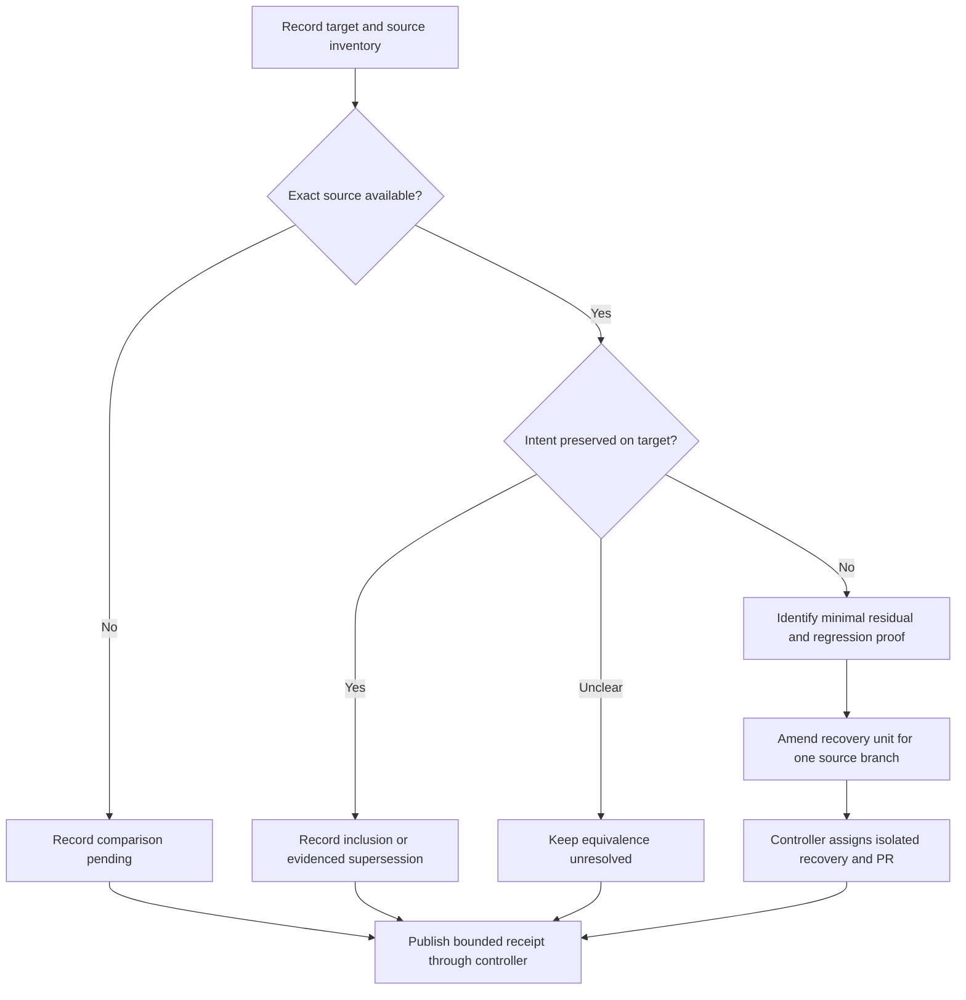

# fe-1 Stranded Branch Triage - Plan

## Goal Capsule

- **Objective:** Account for useful work from the five named branch families on folio-enrich's target `main`, and isolate anything still missing for review and landing.
- **Means:** Compare source branches with landed history and current behavior before attempting recovery (KTD1).
- **Authority:** The supplied `fe-1` mandate and standing lane rules; the chief repository's `docs/plans/2026-10-26-0705-feat-codex-drawdown-campaign-plan.md`, limited to its Goal Capsule and campaign R11, R15, R16, R17, R19, R20. The chief document is unavailable in this sandbox; its contents have not been verified. Local `R` identifiers below belong to this plan.
- **Execution boundary:** This stage produces only a committed plan on `drawdown/fe-1`. Later build work performs the verification and reconciliation described below. No tests or application code ran during planning.
- **Delivery:** The worker commits locally. The controller supplies missing source inputs, scans, pushes and opens each necessary PR; the campaign merge gate owns merging (R6).
- **Stop conditions:** Missing source tips block their exact comparisons. Missing authority excerpts block full campaign-conformance claims. Neither prevents independent local verification and a clearly bounded receipt; protected work remains excluded by R5.

---

## Product Contract

### Summary

Reconcile the mandate with the supplied checkout, verify the relevant landed behavior, and record each exact source branch's disposition. All five families already have landing evidence and matching current code. No production recovery is justified by the available evidence; a newly demonstrated missing change requires a concrete recovery unit before implementation.

### Problem Frame

The mandate calls these branches stranded, but the supplied checkout includes their apparent landings and later annotation improvements. Replaying old branches could duplicate completed work or overwrite newer behavior. Conversely, a landing commit alone cannot prove that an unavailable source tip contains no additional work, particularly after a squash merge.

### Requirements

**Inventory and disposition**

- R1. Re-verify the controller-supplied target snapshot and enumerate every exact source ref matching the five mandate families, preserving unknown inventory entries explicitly.
- R2. Record landing evidence, current implementation evidence, source-tip comparison, and residual disposition separately for each exact source branch.
- R3. Recover only demonstrated, still-needed source changes; retain subsequent behavior and leave unresolved equivalence visible.

**Verification and preservation**

- R4. Run appropriate existing tests during the build stage and add regression coverage for any recovered behavior; never delete, weaken, newly skip, or quarantine an existing test to obtain a pass.
- R5. Preserve Palsgraf gold review, human U6 validation, committed gold and deferred proposition fields. This item authorizes no schema migration, data rewrite, package release, outside service, spend, credential/security-setting change, real-person send, unbacked deletion or force-push. Prohibited secret-file reads remain prohibited under the supplied campaign R11 rule.

**Delivery and evidence**

- R6. Keep this lane on `drawdown/fe-1` with no remote or credential discovery; each actual residual source branch receives its own controller-managed PR rather than a combined recovery PR (campaign R15, R17, R19).
- R7. Commit a public-safe receipt with repo-relative paths, exact snapshot identities and separate pass/fail/skip/not-run outcomes. A frontend change requires an actual Playwright screenshot committed under `docs/plans/evidence/` and named in the build-stage final message (campaign R15, R16).
- R8. Route missing repository inputs to the controller. A genuine Damien-only blocker follows campaign R20's decision format, with independent work completed first and no message sent.

### Scope Boundaries

Only `ci/drain-backend-tests`, `feat/drain-insights-bridge`, `codex/scoped-annotation-access*`, `codex/proposition-review-workspace*`, and `fix/u10-deterministic-runner-config` are in scope. The wildcard families require enumeration; the named landing is not proof that every variant is reconciled.

Existing CI, bridge and annotation behavior is examined to determine whether its source work landed. New CI development (`fe-2`), bridge development (`fe-3`), annotation polish (`fe-4`) and NER/dependency work (`fe-5`) remain separate items. No sibling-repository implementation or live insights deployment is included.

Automatic branch deletion is considered and excluded: the mandate asks to land useful work, and absent source tips prevent a safe retirement claim. No new triage framework or test harness is needed for a bounded evidence document.

### Acceptance Examples

- AE1. Covers R1–R2. An available workspace tip is an ancestor of the supplied target and its UI survives in current code; its row records reconciliation without replaying that branch.
- AE2. Covers R1–R2. A squash landing and current implementation exist but the original source tip is absent; the row records a represented landing and a pending source comparison, not full reconciliation.
- AE3. Covers R3–R4. A supplied source diff exposes a still-needed change; recovery uses its smallest applicable patch, preserves newer behavior, and gains a test that would catch the omission.
- AE4. Covers R4, R7. A browser check skips because Chromium is unavailable; the receipt records the skip and leaves browser acceptance outstanding.
- AE5. Covers R6. Two source branches contain residuals; the controller creates separate work assignments and PRs rather than combining them in this lane.

---

## Planning Contract

### Verified Starting State

Planning inspected a clean `drawdown/fe-1` at `26e5c61b44e3165d3f2bfad5214516a6d6dcede3`, the merge for PR #47. There is no local `main`, `origin/main` or remote. Treat this as the provided target snapshot, not proof of the live remote's current head. The only other local head is `codex/proposition-review-workspace-final` at `a6e713cc289cb833cbced2d71df8f9b9d9e80dd0`.

| Mandate family | Landing in supplied ancestry | Current source evidence | Comparison limit |
|---|---|---|---|
| `ci/drain-backend-tests` | `fe7f462` / PR #45 | `.github/workflows/tests.yml`; clock-relative JWKS expiry in `backend/tests/test_cf_access.py`; deterministic DNS fixture in `backend/tests/test_ontology_ingestion.py` | Original source tip absent; squash equivalence unproven |
| `feat/drain-insights-bridge` | `d424876` / PR #44 | `backend/app/services/proposition/source.py`, `backend/app/services/export/propositions_exporter.py`, `backend/app/services/insights_client.py`, `backend/app/services/post_job/flow.py`, `frontend/index.html` | Original source tip absent; enrich-side landing only, not cross-repo acceptance |
| `codex/scoped-annotation-access*` | `f536436` / PR #37, including `f48ed16` | `backend/app/api/auth.py`, `backend/app/api/routes/gold.py`; later access handling remains present | Merged release parent is available in history; all wildcard tips are not enumerated |
| `codex/proposition-review-workspace*` | `a6e713c` / PR #40, including `737ecb5` | Context pane and one-item review lens in `frontend/index.html`; later bridge and fast-gold changes remain present | Available `-final` branch is an ancestor; other wildcard variants unknown |
| `fix/u10-deterministic-runner-config` | `bb576ac` / PR #38 | `PINNED_SCORING` in `backend/eval/synthetic_runner.py`; configuration/restoration checks in `backend/tests/test_synthetic_runner.py` | Original source tip absent; squash equivalence unproven |

These are source and ancestry observations, not fresh test results. No missing implementation was established.

### Key Technical Decisions

- KTD1. **Compare exact sources before recovery.** Ancestry establishes inclusion of a known commit; squash landings additionally need source-diff or patch-equivalence analysis. Current code and tests establish whether the source intent survives later changes. The receipt keeps these forms of evidence separate (R1–R3).
- KTD2. **Preserve the current implementation.** Recover minimal missing behavior rather than replace whole files from historical branches. In particular, retain access controls, legacy IDs alongside content IRIs, independent review/push choices, dirty-edit preservation, and newer fast-gold behavior (R3–R5).
- KTD3. **Use existing verification entry points.** Follow the locked backend workflow and intercepted-API Playwright tests. Record selection and dependency limitations rather than treating a green default suite as proof that every specialized check ran (R4, R7).
- KTD4. **Keep publication with the controller.** A new residual requires an amended unit identifying its source SHA, missing behavior, exact production/test files and acceptance evidence. Additional residual branches return to separate controller assignments under R6; the worker neither invents branches nor obtains GitHub access.
- KTD5. **Astra remains the execution model.** (session-settled: user-directed — chosen over the Sol-first ladder: the campaign fixes the model choice.)
- KTD6. **Proceed without Damien's time through 2026-10-30.** (session-settled: user-directed — chosen over waiting for him: independent work must continue.) Missing source copies are controller inputs under R8.
- KTD7. **Keep the campaign's expansion and exhaustion rules.** Expansions merge behind guardrails (session-settled: user-directed — chosen over holding them for review: campaign authorization already settles routine acceptance). Exhausted planned work leads to durable hygiene (session-settled: user-directed — chosen over speculative features: preserve the campaign's scope). Neither creates expansion work in this `planned` item.

### Assumptions and Missing Inputs

- **Unvalidated assumption:** the controller supplied `26e5c61` as the intended `main` snapshot. Refresh its identity at build start and before publication; repeat affected comparisons if the base changes.
- **Missing authority:** the chief campaign plan's Goal Capsule and cited R-ID excerpts are not mounted. The supplied standing rules are usable, but cannot establish agreement with unseen source text.
- **Missing origin context:** `docs/handoffs/2026-10-26-unified-proposition-engine-brainstorm.md` is absent from the worktree and available history. Do not infer Phase B scope from its filename.
- **Missing source inventory:** the controller must supply exact refs/SHAs or local source bundles, including wildcard variants. An explicit authoritative record that a source was deleted or unavailable may close inventory with a stated limitation; it cannot prove patch equivalence.

These inputs limit exhaustive closure, not the local audit and verification units. No Damien decision is currently needed.

### Disposition Flow

### Sources and Constraints

- `docs/plans/2026-08-16-2234-feat-proposition-system-phase-a-plan.md`: annotation contracts, byte neutrality, gold provenance and human-cycle ownership. Its historical dependency and UI assumptions do not override newer code.
- `docs/plans/2026-09-30-palsgraf-cycle-1-reconciliation.md`: evidence reconciliation is distinct from human gold validation; polarity and per-opinion stance stay deferred.
- `docs/plans/2026-10-09-backend-ci-lane-plan.md`: its October 20 revision withdraws the old quarantine proposal. Preserve existing test selection and do not restore skips/xfails.
- `docs/plans/2026-10-09-0645-feat-insights-bridge-plan.md` and `docs/bridge-retirement-2026-10-09.md`: distinguish enrich-side delivery from sibling-repository work. Their U5/U6 labels are local to those documents and do not authorize the human-validation U6.
- `docs/solutions/2026-07-07-ner-eval-gold-set-harness.md`: adjacent lesson on explicit marker/timeout accounting; historical NER results are not acceptance evidence for this item.

No repository or ancestor `AGENTS.md`/`CLAUDE.md` was present. The supplied instructions govern this checkout. No external service research is needed to reconcile local commits and source behavior.

---

## Implementation Units

### U1. Reconcile the source inventory against the target

- **Goal:** Give the controller an accurate disposition for every supplied source branch.
- **Requirements:** R1–R3, R6, R8; AE1–AE2, AE5; KTD1, KTD4–KTD7.
- **Dependencies:** None for the bounded local inventory; exact comparisons depend on the missing inputs above.
- **Files:** Create `docs/plans/evidence/fe-1-stranded-branch-triage.md`. Read the current source paths in the starting-state table and the named authority excerpts when supplied.
- **Approach:** Record the new target SHA and dirty state, then compare each exact source tip. Each receipt row names its family, source ref/SHA or explicit absence, landing SHA, ancestry result, current paths, comparison method and residual disposition. Keep wildcard coverage separate from the known landings. Cite preserved intent before declaring a branch superseded.
- **Patterns to follow:** The September 30 reconciliation's distinction between observed facts and unverified conclusions.
- **Test expectation:** No new tests for the documentation unit. Audit ancestry and source diffs without treating commit subjects as sufficient proof.
- **Verification:** Every supplied ref has an evidenced disposition; unavailable refs and authority inputs remain visible. No blanket claim covers unknown wildcard variants.

### U2. Verify the represented behavior on the supplied snapshot

- **Goal:** Establish fresh, bounded verification evidence for the five represented landings.
- **Requirements:** R3–R5, R7; AE3–AE4; KTD2–KTD3.
- **Dependencies:** U1's recorded target; unavailable source tips do not block current-tree checks.
- **Files:** Existing production paths in the starting-state table; tests listed in the Verification Contract; append results only to `docs/plans/evidence/fe-1-stranded-branch-triage.md` unless a later amended recovery unit permits code changes.
- **Approach:** Run focused checks and the default backend suite with existing exclusions intact. Use fixtures, isolated temporary state and intercepted HTTP; no production data or live insights push. Distinguish a reproduced behavior defect from missing tooling, timeout or sandbox socket failure.
- **Execution note:** Obtain baseline evidence before changing any behavior. A serial diagnostic run after a parallel-runner sandbox failure must be labeled separately from CI-equivalent execution.
- **Test scenarios:** Use the existing tests to establish the branch-specific behaviors in the Verification Contract. No new assertion is needed solely to restate the audit.
- **Verification:** The receipt names the command, exact revision/tree state, exit status, selected/passed/failed/skipped totals, marker exclusions and reasons for missing coverage. Historical totals never substitute for a fresh run.

### U3. Record residual work and deliver the bounded receipt

- **Goal:** Make the remaining work, if any, concrete enough for the controller to publish or assign independently.
- **Requirements:** R2–R8; AE2–AE5; KTD1–KTD4, KTD6–KTD7.
- **Dependencies:** U1 and available U2 results.
- **Files:** `docs/plans/evidence/fe-1-stranded-branch-triage.md`; this plan only if a demonstrated residual requires a new recovery unit. Conditional frontend evidence: `docs/plans/evidence/fe-1-proposition-review.png`.
- **Approach:** State whether any residual was actually established. For each one, record source SHA, missing behavior, affected files, preserving tests and dependency order. Amend the plan with that exact recovery unit before code work; assign multiple source branches separately under R6. If none is established, finish with the receipt and its explicit limitations, without manufacturing recovery commits.
- **Test expectation:** No new tests for this documentation unit. An amended feature-bearing recovery unit must name actual regression test files and scenarios under R4; frontend recovery must satisfy R7.
- **Verification:** The final diff contains only authorized work, and the controller can distinguish completed local reconciliation from pending source comparisons and behavioral checks. Preserve unrelated files and backup requirements when excluding abandoned work.

---

## Verification Contract

The checked-in baseline is `.github/workflows/tests.yml`: Python 3.13, uv 0.9.22, frozen dev dependencies and spaCy model 3.8.0. Its backend command is `uv run --no-sync python -m pytest tests/ -q -n 2 -ra -p no:cacheprovider`, run from `backend`. Use the available dependency caches and preserve the lockfile. `backend/pyproject.toml` excludes `slow`, `demo_regen` and `eval` by default; overriding those exclusions could invoke unrelated live or paid work.

| Area | Existing verification files | Required evidence |
|---|---|---|
| CI landing | `.github/workflows/tests.yml`, `backend/pyproject.toml`, `backend/tests/test_ontology_ingestion.py`, `backend/tests/test_cf_access.py` | Pull-request/main workflow scope and locked suite remain present; DNS and clock-relative expiry cases execute successfully |
| Shared identity and export | `backend/tests/test_proposition_content_identity.py`, `backend/tests/test_propositions_export.py`, `backend/tests/test_proposition_byte_neutral.py` | Content IRIs coexist with legacy IDs; shared-schema/flat NDJSON exports and disabled-feature neutrality survive |
| Insights and post-job flow | `backend/tests/test_insights_client.py`, `backend/tests/test_insights_route.py`, `backend/tests/test_post_job_flow.py`, `backend/tests/test_post_job_access_and_recovery.py` | Offline error handling, independent choices, access gating, override races and recovery retain their contracts |
| Scoped annotation and gold | `backend/tests/test_admin_auth.py`, `backend/tests/test_cf_access.py`, `backend/tests/test_gold_store.py`, `backend/tests/test_gold_validity.py`, `backend/tests/test_gold_validation.py` | Annotation/admin boundaries, provenance and export gates survive; automated tests do not establish human validation |
| Evolved review workspace | `backend/tests/test_insights_browser.py`, `backend/tests/test_post_job_browser.py`, `backend/tests/test_fast_gold_browser.py`, `backend/tests/test_insights_frontend.py`, `backend/tests/test_post_job_frontend.py`, `backend/tests/test_frontend_assets.py` | Current UI behavior is retained, including dirty edits during async status arrival; skips remain skips |
| Deterministic U10 runner | `backend/tests/test_synthetic_runner.py` | Successful-run pinning, recorded configuration and restoration; malformed-input and missing-provider failures. Restoration after execution failure remains unverified by this suite |

Browser tests use `backend/tests/browser_support.py` and the existing scripts under `backend/tests/browser/`. No dedicated test for the original context-pane/one-item-lens identifiers was found; the current browser tests cover the evolved workspace. If recovery changes that interaction, the amended unit must add a direct regression scenario instead of assuming existing coverage proves it.

The planning commit needs document review and whitespace/path checks only. No frontend changed during planning, so no screenshot is required for this stage. For build-stage frontend changes, a skipped browser run does not satisfy R7; the controller must arrange executable Playwright coverage before behavioral acceptance.

---

## Definition of Done

- U1 accounts for every supplied exact source ref and explicitly identifies incomplete wildcard inventory.
- U2 reports fresh verification or exact environmental limits without claiming unrun checks passed.
- U3 supplies a committed, public-safe receipt and a concrete controller handoff for each genuine residual.
- A completed local receipt is not full campaign closure while source comparisons, authority inputs or required behavioral checks remain unresolved.
- Full `fe-1` closure requires the controller's complete source inventory, disposition of each relevant residual, and review/verification for any recovered code; already-landed work receives no duplicate recovery PR.
- No tests were weakened, protected gold work was altered, or speculative feature was added. The diff contains no abandoned implementation or unrelated changes.
