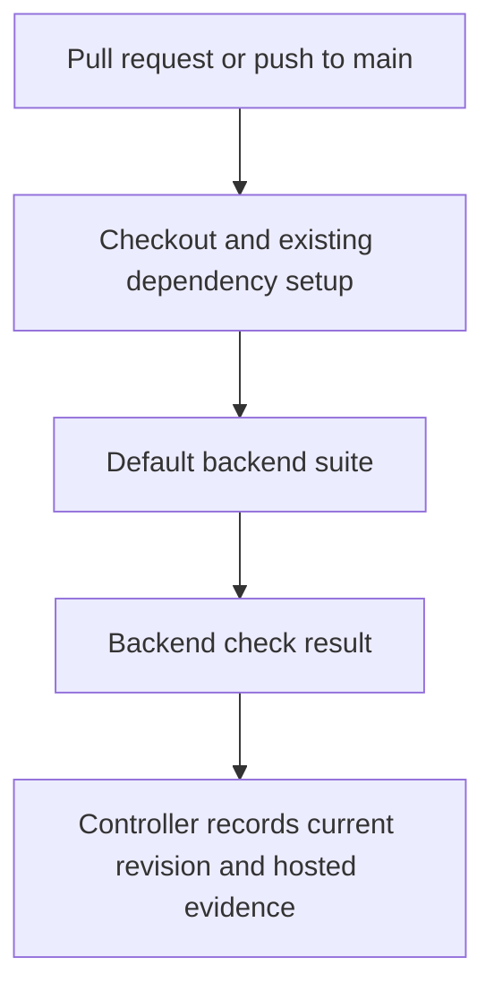

# Backend CI drain verification - Plan

## Goal Capsule

- **Objective:** Contributors receive trustworthy backend regression results on every pull request.
- **Means:** Verify and document the existing backend CI lane (KTD1); its promotion is already present in the supplied baseline.
- **Authority:** Drawdown mandate item `fe-2` and the standing lane rules govern this work. The chief repository's `docs/plans/2026-10-26-0705-feat-codex-drawdown-campaign-plan.md` remains campaign authority; its Goal Capsule and cited R11, R15, R16, R17, R19, and R20 were unavailable in this clone. Their references below come from the supplied mandate, not an independent reading of that plan.
- **Execution and delivery:** This stage creates and commits only this plan on `drawdown/fe-2`. A later build stage performs U1 and U2. The controller publishes the branch and obtains hosted evidence; the campaign merge gate handles integration under campaign R15/R19. No remote or credential discovery belongs in this clone.
- **Stop conditions:** Preserve the boundaries in R4 and R5. An unavailable test environment leaves verification incomplete; it does not authorize weaker tests or substitute success claims.

---

## Product Contract

### Summary

Close the remaining evidence and documentation gaps around the backend CI lane already delivered by PR #45. Preserve the workflow and test selection unless a reproduced failure demonstrates a bounded defect in this lane.

### Problem Frame

The requested promotion is already present in the supplied baseline. At `26e5c61b44e3165d3f2bfad5214516a6d6dcede3`, ancestor `fe7f46249ecb19cebda42e7efe509c6dc499ea11` already contains the backend workflow and its two determinism fixes. Rebuilding that promotion would duplicate completed work. Repository inspection establishes what is configured, but it does not establish that dependencies install or tests pass today.

### Requirements

**Pull-request feedback**

- R1. Every pull request receives the existing default backend-suite check without repository path or target-branch filters; retain the existing push-to-`main` coverage. This is mandate `fe-2`, subject to GitHub's ordinary event eligibility and approval rules.
- R2. A completed backend check reflects the selected tests' real result; failures must not be hidden by new exclusions, skips, expected failures, or success overrides.
- R3. Acceptance evidence identifies the tested revision, environment, actual results, and limitations, with hosted results distinguished from local checks.

**Lane boundaries**

- R4. Preserve existing tests and the current default/optional test tiers. Do not introduce migrations, data rewrites, package releases, new outside services, spend, credential or security-setting changes, real-person sends, unbacked deletion, or force-push. Applies the supplied campaign R11/R15/R16 guardrails.
- R5. Work only `fe-2` on `drawdown/fe-2`; keep artifacts public-safe with repository-relative paths and no secrets or private matter text. Publication remains controller-owned under supplied campaign R17/R19; controller-owned evidence gaps do not become requests for Damien under R20.

### Scope Boundaries

This item covers the existing PR backend-test lane, instructions for reproducing it, and evidence that its selected suite executes successfully. It does not cover stranded-branch integration (`fe-1`), bridge work (`fe-3`), annotation UI (`fe-4`), or the NER/dependency audit (`fe-5`).

Palsgraf gold review, Phase A U6 human validation, and proposition fields deferred by `docs/plans/2026-09-30-palsgraf-cycle-1-reconciliation.md` remain untouched. No frontend change is planned, so no screenshot is required for this item.

Considered and not added:

- **A second workflow or a test that mirrors workflow text:** the existing workflow implements R1; inspect and execute it directly. Reconsider only if execution exposes a gap that existing verification cannot detect.
- **Mandatory browser, embeddings, or evaluation tiers:** those have separate prerequisites and established selection rules. Changing them would expand R4's scope; a separate mandate would be needed.
- **Branch-protection configuration, new retries, or broader timeouts:** these are not needed to verify the current lane. A visible failure is evidence to diagnose, not a reason to add speculative safeguards.

---

## Planning Contract

### Verified Starting State

These findings come from source and local history only. No test, dependency installation, application, workflow dispatch, or hosted-run inspection was performed during planning. The clone has no remote and no local `main` ref; the supplied baseline was not independently compared with live `origin/main`.

| Evidence | Current finding | Implication |
|---|---|---|
| `.github/workflows/tests.yml` | `pull_request` without filters; push on `main`; job `backend-tests` | CI promotion exists in the supplied baseline. |
| Same workflow | Read-only contents permission, checkout without persisted credentials, 20-minute job timeout, cancellation of superseded runs | Preserve the existing execution boundary. A cancelled old run is not passing evidence. |
| Same workflow and `backend/pyproject.toml` | Python 3.13; uv 0.9.22; setup-uv pinned to a SHA; frozen dev dependencies; spaCy model 3.8.0 release wheel; no-sync test invocation | Reproduce the established environment without updating dependency pins. |
| `backend/pyproject.toml` | Strict markers, 30-second test timeout, default exclusion of `slow`, `demo_regen`, and `eval` | Default-suite success does not certify the excluded tiers. |
| `backend/tests/browser_support.py` and the three browser test modules | Browser tests skip when required local tooling is unavailable | Counts can differ by environment; preserve and report skip reasons. |
| `backend/tests/test_cf_access.py` and `backend/tests/test_ontology_ingestion.py` | Expiry relative to the monotonic clock; allowlisted-host DNS stub | The prior CI defects already have regression coverage. |
| `docs/plans/2026-10-09-backend-ci-lane-plan.md` | October 20 revision withdraws the earlier quarantine instructions | Do not restore historical skip/xfail proposals. |
| `README.md`, Testing | Basic pytest command and historical totals, without the full backend CI setup/scope | Add reproducible instructions and avoid undated totals as acceptance evidence. |

### Key Technical Decisions

- KTD1. **Verify the landed lane before changing it.** U1 establishes whether any implementation work remains. U2 documents the result. The ancestor commit and current workflow support this approach; a duplicate promotion adds no coverage. Governs R1–R3.
- KTD2. **Keep the current test contract.** Use the workflow's frozen dev installation, pinned model, and no-sync two-worker invocation. Preserve the marker expression and optional tooling behavior in `backend/pyproject.toml` and `backend/tests/browser_support.py`. Governs R2/R4.
- KTD3. **Bind evidence to the source tested.** Record the tested commit and relevant working-tree changes; the controller separately records the final PR revision and hosted job URL. Documentation-only edits after a test run need diff review, while any workflow, test, dependency, or application repair requires affected verification again. Governs R3.
- KTD4. **Preserve campaign execution choices.** Use Astra rather than the Sol-first ladder; close bounded verification and documentation work rather than inventing features or waiting for Damien through 2026-10-30. (session-settled: user-directed — chosen over the Sol-first ladder, speculative features, and synchronous review: the campaign sets those execution constraints.) Governs R5.

### Assumptions and Deferred Verification

- **Assumption:** “Backend suite” means the established default tier used by the dedicated drain, rather than overriding all registered markers. The prior CI plan and current workflow support this interpretation.
- **Source availability:** Neither the chief campaign plan nor `docs/handoffs/2026-10-26-unified-proposition-engine-brainstorm.md` is present. The controller must reconcile their relevant constraints before accepting closure. Available Phase A and reconciliation documents establish the protected human-review and schema boundaries; missing sources are not represented as reviewed.
- **Execution-time unknowns:** Current test counts, clean installation, runtime, and hosted success remain unmeasured. Unix-socket restrictions may prevent the exact two-worker command in this sandbox. Record any restriction and pass the unchanged verification obligation to the controller's permitted runner.
- **Dependency access:** The existing lock includes a GitHub dependency and the workflow installs a model release wheel. A cache miss or network failure is an installation limitation, not authority to find credentials, change pins, or add a service.

### Existing Execution Flow

The workflow has no success override on installation or pytest. Its concurrency policy may cancel a superseded run; the current revision still needs a completed result for acceptance under R3.

---

## Implementation Units

### U1. Verify the existing backend CI lane

- **Goal:** Establish fresh, reproducible evidence for the behavior already required by R1–R3.
- **Requirements:** R1–R4; KTD1–KTD3.
- **Dependencies:** Supplied baseline, existing toolchain, and a permitted environment for the exact workflow invocation.
- **Files:** Inspect `.github/workflows/tests.yml`, `backend/pyproject.toml`, `backend/uv.lock`, `backend/Dockerfile`, and `backend/tests/conftest.py`; exercise `backend/tests/`, especially `backend/tests/test_cf_access.py` and `backend/tests/test_ontology_ingestion.py`. No production or test-file changes are planned.
- **Approach:**
  1. Recheck the starting revision and inherited workflow before executing anything; preserve unrelated work.
  2. Validate workflow syntax and the R1 trigger/failure contract, then reproduce the existing environment and default-suite invocation.
  3. Record selected, passed, failed, skipped, and deselected counts with skip reasons and elapsed time when execution provides them. Separate setup failure, test failure, timeout, cancellation, and unexecuted work.
  4. Investigate only demonstrated lane failures. A bounded repair must preserve R2/R4 and add regression coverage in the affected test module; a broader change remains outside this plan. Do not modify tests merely to accommodate sandbox restrictions.
- **Patterns to follow:** The existing deterministic DNS and monotonic-expiry fixtures; `docs/plans/2026-10-09-backend-ci-lane-plan.md`'s October 20 revision.
- **Execution note:** Runtime verification comes first; no new test is justified for unchanged behavior.
- **Test scenarios:**
  1. A PR affecting only documentation remains eligible for the same backend job because the workflow has no path filter.
  2. The workflow's default command runs the established selected suite without paid-provider credentials or extra optional tiers.
  3. An expired JWKS cache with an unavailable fetcher denies the request, including on a newly started host.
  4. The allowlisted ontology URL test exercises the public-IP gate using its DNS stub without relying on live DNS.
  5. Missing optional browser tooling retains the existing explicit skips; failed installation or a denied socket never becomes a passing suite result.
- **Verification:** Syntax/structure evidence and a fresh default-suite result are recorded, or the specific unmet verification is named. Existing focused regression coverage remains intact. No test additions are expected unless a reproduced defect requires a repair.

### U2. Document reproduction and the verification result

- **Goal:** Contributors and the controller can reproduce and assess the backend check without relying on historical test counts.
- **Requirements:** R1–R5; KTD1–KTD4.
- **Dependencies:** U1 results, including any execution limitations.
- **Files:** Update `README.md`'s Testing guidance; create `docs/plans/evidence/2026-10-26-fe-2-backend-ci-verification.md`.
- **Approach:**
  1. Document the existing workflow's environment, setup order, invocation, default exclusions, and optional browser/embeddings behavior. Distinguish the separate eval workflow and its existing triggers without redesigning it.
  2. Replace or date historical test-count claims in the affected guidance rather than presenting them as current results.
  3. Write a sanitized receipt with the tested revision, working-tree state relevant to the run, actual commands, environment versions, results, and limitations under KTD3. Keep pending controller checks explicit; do not paste raw environment output or unreviewed logs.
  4. Hand the controller the local receipt and the outstanding current-PR job and campaign-source checks. The receipt must not claim its own future commit hash or imply publication occurred locally.
- **Test expectation:** None for documentation-only changes. Review commands and explanations against the existing workflow and manifest; any U1 repair still needs its own regression verification.
- **Verification:** A reader can distinguish configured behavior, measured local results, and pending hosted evidence. The diff contains only the scoped documentation plus any separately justified U1 repair.

---

## Verification Contract

The commands below are existing verification entrypoints for the later build stage, not results obtained while planning.

| Gate | Check | Required evidence |
|---|---|---|
| Workflow | Validate `.github/workflows/tests.yml` with `actionlint` when available; otherwise use a YAML parser that preserves the `on` key and inspect trigger, working-directory, setup, and failure behavior explicitly | Name the validator and limitations; parser success alone does not establish hosted execution. |
| Environment | Reproduce the workflow's Python/uv versions, frozen dev sync, and pinned spaCy model installation | Versions and setup result; unchanged manifest and lockfile. |
| Default backend suite | From `backend/`: `uv run --no-sync python -m pytest tests/ -q -n 2 -ra -p no:cacheprovider` | Actual outcome, duration, counts, and reasons for skips/deselections tied to the tested revision. |
| Existing determinism coverage | Confirm the U1 regression cases execute in the full suite; run the named files separately only if attribution or a repair requires it | The monotonic-clock and DNS cases pass; no skip/xfail or assertion weakening. |
| Documentation | Compare README guidance and the receipt against workflow/configuration and actual results; review the diff for public-safe paths and content | No stale count presented as fresh, fabricated pass, machine-local path, secret, or unrelated change. |
| Hosted acceptance, controller-owned | Completed `backend-tests` run for the published PR revision, plus relevant campaign authority reconciliation | Published revision, job URL, and conclusion. Cancelled, unavailable, or merely configured checks do not satisfy this gate. |

Expected coverage follows `backend/pyproject.toml`; do not enforce README's historical total as a fixed test count. No screenshot, application deployment, release, or migration is part of this verification.

---

## Definition of Done

- U1 establishes the current lane's configuration and fresh passing selected-suite evidence under R1–R4.
- U2 supplies accurate contributor instructions and a durable, public-safe receipt under R3/R5.
- The controller supplies hosted current-revision evidence and checks the unavailable campaign sources before marking the campaign item verified. A completed local stage may hand off these pending obligations explicitly.
- The final diff preserves all existing tests and contains no unrelated or abandoned experimental changes. If no defect is reproduced, workflow, dependencies, application code, and test files remain unchanged.
- This planning stage ends with only the plan committed locally; implementation and hosted verification remain for their assigned later stages.

### Sources

- `.github/workflows/tests.yml` and local ancestor `fe7f46249ecb19cebda42e7efe509c6dc499ea11` (PR #45).
- `docs/plans/2026-10-09-backend-ci-lane-plan.md`, especially its October 20 correction.
- `docs/plans/2026-08-16-2234-feat-proposition-system-phase-a-plan.md`, protected U6 and verification boundaries.
- `docs/plans/2026-09-30-palsgraf-cycle-1-reconciliation.md`, deferred fields and human-validation limits.
- `docs/solutions/2026-07-07-ner-eval-gold-set-harness.md`, separate evaluation markers and timeout requirements; historical totals are not current acceptance evidence.
