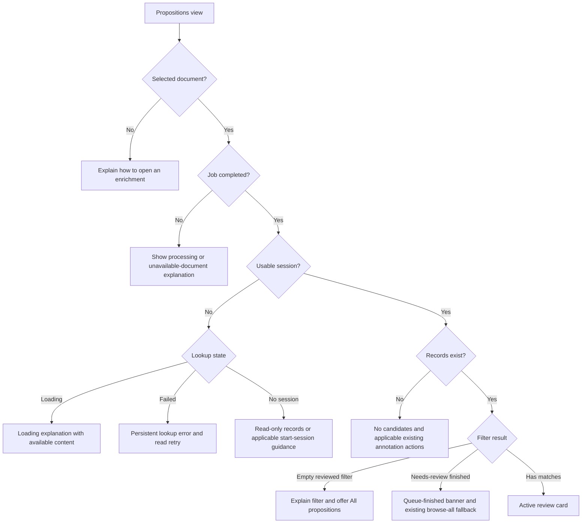
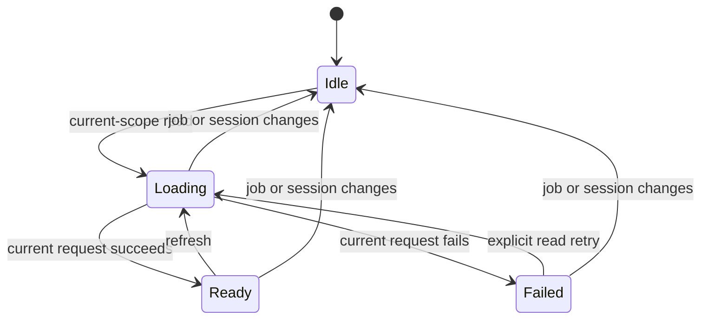

# Annotation UI Polish - Plan

## Goal Capsule

- **Objective:** An annotator can move through propositions by keyboard, understand each review and save state, and recover from an empty view or failed request without losing their place or edits.
- **Means:** Extend the existing single-card review workspace and synthetic browser tests (KTD1–KTD4).
- **Authority:** Mandate item `fe-4` only, an expansion. The chief repository's `docs/plans/2026-10-26-0705-feat-codex-drawdown-campaign-plan.md` governs the campaign; the supplied mandate cites Campaign R11, R15, R16, R17, R19, and R20. Source availability is recorded below. Plan-local R-IDs are separate from Campaign R-IDs and Phase A R-IDs.
- **Execution profile:** One item on `drawdown/fe-4`. This stage delivers a committed plan only. The later build stage implements, simplifies, reviews, verifies, and commits locally; the controller scans, pushes, and opens the PR, and the campaign merge gate handles merging (Campaign R15, R17, R19). This clone has no remote or GitHub login; neither is to be added or sought.
- **Stop conditions:** Scope requiring schema changes, data rewrites, package releases, outside services, or changes to human gold validation is outside this item. Preserve the hard stops in R6.

---

## Product Contract

### Summary

Polish the annotation workspace already delivered by fast gold annotation: retain keyboard focus through navigation and background updates, distinguish review decisions from legal disposition and persistence, and provide contextual empty states and durable errors with safe recovery actions.

### Problem Frame

The supplied checkout already contains the fast annotation merge at `26e5c61b44e3165d3f2bfad5214516a6d6dcede3`. Arrow navigation, shortcuts, optimistic saves, retry, undo, source selection, help, and phone controls exist. Rebuilding these features would duplicate landed work.

Static inspection identifies narrower gaps. Replacing the card and source markup can lose focus. Raw outcomes such as `accepted` overlap legal disposition terminology. One generic empty message covers unrelated situations, while session read failures appear only in a toast and a failed completeness refresh can leave misleading text. These are source findings, not claims from a browser run.

### Requirements

**Keyboard and state clarity**

- R1. Keyboard navigation keeps the user's position and intended focus through explicit navigation and asynchronous refreshes; existing shortcuts, dirty-edit protection, and native control behavior remain usable.
- R2. Review outcome, legal disposition, and persistence are visibly distinct, including drafts, pending saves, failures, and read-only items.
- R3. Empty and transitional views explain the current situation and offer only applicable existing actions; completing the review queue retains the existing browse-all fallback.
- R4. Annotation errors remain visible in their relevant context until corrected, successfully retried, or left behind by a scope change; recovery preserves edits and targets the failed operation.
- R5. The changes use the existing visual style at desktop and phone widths, with visible focus, text labels beyond color, accessible control names, and concise status announcements.

**Integrity and delivery**

- R6. Preserve persisted values, API contracts, queue ordering, undo, explicit unresolved confirmation, blind/coverage requirements, and server export enforcement. Do not change Palsgraf gold records, conduct or claim human U6 validation, introduce deferred proposition fields, or undertake other mandate items. No spend, credential or security-setting changes, sends in the user's voice, deletion without verified backup, or force-push. Never read `.env*`, `*.pem`, `*.key`, `twin-secrets/`, secrets directories, or credential files (Campaign R11).
- R7. Add behavioral tests for the changes without deleting, weakening, or skipping existing tests. Build acceptance requires an actual Playwright run and inspected screenshots committed under `docs/plans/evidence/`, with evidence paths reported by the build worker (Campaign R15, R16).
- R8. Deliver this expansion through the campaign's local-commit and controller publication boundary; identify any unavoidable human-only dependency using the mandate's decision format (Campaign R17, R19, R20).

### Acceptance Examples

- AE1. **Covers R1, R5.** With the review card focused, two Right Arrow presses visit the next two eligible propositions without requiring a click. A delayed save or completeness response then arrives without moving focus to the document body or interrupting an editor.
- AE2. **Covers R1, R6.** A different source highlight receives keyboard focus while the current card has unsaved edits. Activating the highlight preserves those edits and leaves focus at the existing dirty-edit guard's editor. Pressing an item mutation shortcut on an unactivated highlight cannot change a different card.
- AE3. **Covers R2, R6.** A proposition whose legal disposition is `rejected` is approved as an annotation. It displays review outcome “Approved” and legal disposition “rejected”; a failed PATCH still displays “Not saved — retry” and keeps export blocked by the existing unsaved-write rule.
- AE4. **Covers R3, R4.** A failed session lookup displays a persistent error. Retry performs a lookup for the current job, never session creation. A successful retry with no matching session explains that state without discarding extracted propositions available for read-only browsing.
- AE5. **Covers R2–R4.** After a successful save, the completeness request fails. The workspace reports saved actions and unavailable completeness separately. Retrying completeness sends no annotation mutation and does not replay the successful save.

### Scope Boundaries

- Extend `frontend/index.html` and the existing synthetic browser test path. No frontend framework, new test framework, new shortcut vocabulary, or generalized networking/state-management layer is needed.
- Keep shortcut help accurate, including the existing same-type behavior: choosing the current type approves rather than inventing an edit.
- Preserve existing client export eligibility. Unknown or incomplete completeness information is explanatory; this item adds no new export gate.
- Do not add bulk approval, automatic retry of annotation mutations, cross-tab editing, offline persistence, or new gold validation workflows. Existing per-session queues and explicit retry cover this item's recovery needs; evidence of a separate persistence defect belongs in follow-up work.
- Historical instructions in the fast-annotation plan to delete screenshots do not apply here; R7 requires committed evidence.

#### Deferred to Follow-Up Work

Branch triage (`fe-1`), CI promotion (`fe-2`), the enrich–insights bridge (`fe-3`), and NER/dependency hygiene (`fe-5`) remain separate items. Phase B extraction work and the unified proposition engine remain outside this annotation polish branch. The reconciliation's deferred polarity and per-opinion stance fields stay deferred.

---

## Planning Contract

### Reverified Starting State and Sources

The branch was clean at `26e5c61b44e3165d3f2bfad5214516a6d6dcede3`, the merge of fast gold annotation. No local `main` reference or remote is available to establish newer upstream state. No tracked or applicable ancestor `AGENTS.md` or `CLAUDE.md` was found in the supplied snapshot. The active instructions are the supplied mandate and standing rules.

| Source | Evidence used |
|---|---|
| `frontend/index.html` | `navigatePropositionReview`, `propositionReviewState`, `focusPropositionCard`, `renderPropositionsTab`, `renderPropositionSaveState`, `ensurePropositionSession`, `refreshPropositionCompleteness`, `propositionReviewBusy`, and the shortcut handler |
| `backend/tests/test_fast_gold_browser.py` | Eight existing scenarios at widths 1280 and 390; tests may skip when Node, Playwright, or Chromium is unavailable |
| `backend/tests/browser/fast_gold_fixture.cjs` | Real frontend with synthetic job/session data, intercepted requests, delayed/failed writes, and no live service |
| `backend/tests/browser/fast_gold_annotation.cjs` | Dispatch to synthetic mode when fixture arguments exist; separate manual mode mutates Palsgraf sessions and must not be used for this item |
| `docs/plans/2026-08-16-2234-feat-proposition-system-phase-a-plan.md` | Phase A R1, R3–R6, R15–R16 and KTD7–KTD8 constrain annotation semantics, server gates, and browser verification |
| `docs/plans/2026-09-30-palsgraf-cycle-1-reconciliation.md` | Review outcome is distinct from legal disposition; human validation is not established by the reconciliation; structural fields remain deferred |
| `docs/plans/2026-10-26-0725-feat-fast-gold-annotation-plan.md` | Landed fast-review intent and no-false-save boundary; current code/tests establish what is implemented |

**Unavailable sources:** The chief repository and its named campaign plan/common mandate file are not mounted in this clone. `docs/handoffs/2026-10-26-unified-proposition-engine-brainstorm.md` is also absent. Their contents were not reconstructed or attributed as read. Campaign references above use only the rules reproduced in the supplied mandate. Before build, the controller should supply the campaign Goal Capsule and cited R-ID excerpts plus the missing handoff, or reconcile this bounded plan against them in its own checkout. This is a controller source-reconciliation prerequisite, not a request for a new product decision or human gold review.

No tests, builds, application starts, or browser probes ran during planning. Runtime baseline and browser availability remain build-stage checks. Local implementation patterns were sufficient; no external research or new dependency recommendation shaped the plan.

### Assumptions

- **Scope assumption:** “Keyboard navigation” means finishing the existing navigation experience, since the core keys and controls have already landed. Replacing that experience is not necessary to satisfy `fe-4`.
- **Presentation assumption:** Retain the current split view, filter choices, theme tokens, native help dialog, and phone action bar. These are reversible UI choices grounded in the current page.
- **Execution prerequisite:** The build runner must support Chromium. The stated sandbox restriction on Unix sockets may prevent launch; a skip or launch failure is not browser acceptance. The controller can provide a compatible runner without changing security settings in this clone.

### Key Technical Decisions

- KTD1. **Extend existing inline ownership.** Keep the feature in `frontend/index.html`, using small presentation and focus helpers around the existing render/action functions. A component migration would enlarge the change without resolving a missing contract. Governs R1–R5.
- KTD2. **Focus follows intent.** Explicit item navigation selects and focuses the resulting card; a rejected dirty navigation preserves the guard's editor focus. Filter changes retain the filter, boundary no-ops retain focus, and background updates preserve the same focused control or semantic target. When an explicit action removes its target, focus moves to the empty-view heading or a stable review control. Help returns focus to its opener or a stable review control if that opener disappeared. Extend current shortcut guards to composition and open native modal dialogs; source-highlight mutation keys must not act on another card. Governs R1, R5.
- KTD3. **Presentation values are separate from domain values.** Use one display mapping for review outcomes: `unreviewed` → “Needs review”, `accepted` → “Approved”, `edited` → “Edited”, `deleted` → “Discarded”, `hand-added` → “Hand-added”. A draft adds “Draft — not saved”. Preserve raw values for storage, selectors, CSS hooks, and requests. Label the editable disposition “Legal disposition”. Keep exact functional labels `All actions saved.` for a loaded, clean session and `Not saved — retry` for existing recovery controls. With no session, show a neutral persistence message. Governs R2, R6.
- KTD4. **Errors and read progress belong to their scope.** Track session-lookup presentation by job and completeness presentation by job/session, with request identity to discard late results. A lookup retry uses read-only intent; completeness retry reads the known session. Retain usable content behind a loading/error banner. Patch status regions while an editor, draft, selection, gesture, or relevant focus needs preservation. The existing mutation queue continues to own save failures and retries. Governs R3, R4, R6.
- KTD5. **Use synthetic acceptance and optional evidence capture.** Extend the existing route-intercepted browser harness and its pytest scenario registration. Add opt-in screenshots to synthetic mode using the existing `FAST_ANNOTATION_SCREENSHOTS` convention, with distinct scenario/viewport/state filenames. Ordinary tests create no committed artifacts; the evidence run writes to the named evidence directory. Governs R7.
- KTD6. **Use the campaign delivery boundary.** (session-settled: user-directed — chosen over holding expansions for human review: guarded expansions proceed through the campaign gate.) Governs R7, R8.
- KTD7. **Keep the selected execution model.** (session-settled: user-directed — Astra chosen over the Sol-first ladder: the campaign explicitly fixes the model.) Governs R8.
- KTD8. **Do not wait for discretionary input.** (session-settled: user-directed — chosen over waiting for Damien through 2026-10-30: the campaign reserves zero time.) Resolve routine implementation choices from evidence; report only essential human dependencies under R8.
- KTD9. **Do not expand beyond the assigned item.** (session-settled: user-directed — durable hygiene chosen over speculative features once planned work and worthwhile expansions run out: finish bounded work.) This branch remains limited to `fe-4` under R6, R8.

### High-Level Technical Design

The presentation decision uses this precedence (R3, KTD4). Available source text and read-only extracted records remain visible wherever possible.

Read lifecycle is independent of candidate outcomes (KTD4):

Late responses from an abandoned request do not transition the current scope. Completeness in Loading or Failed is unknown even if an earlier response was complete. Review progress counts local decisions; save status reports persistence; gold completeness comes only from the current server response. “Queue finished” is not a human-validation or export-readiness claim.

---

## Implementation Units

### U1. Keep keyboard focus and actions on the intended proposition

- **Goal:** The annotator can browse and act without losing focus or changing the wrong card.
- **Requirements:** R1, R5–R7; AE1, AE2; KTD1, KTD2, KTD5.
- **Dependencies:** Recheck the starting commit and source prerequisite before implementation.
- **Files:** `frontend/index.html`, `backend/tests/browser/fast_gold_fixture.cjs`, `backend/tests/test_fast_gold_browser.py`.
- **Approach:**
  1. Characterize explicit navigation, source activation, and delayed updates in the synthetic harness.
  2. Apply KTD2 around current navigation and render entry points, preserving existing dirty/draft/selection/gesture safeguards.
  3. Tighten shortcut targeting and modal/composition guards without introducing new key bindings.
- **Patterns to follow:** `savePropositionOutcome` and `undoPropositionAction` already refocus the resulting card; `propositionReviewBusy` and `applyInsightsStatusUpdate` already avoid replacing busy editors.
- **Test scenarios:**
  - Covers AE1. Arrow and N navigation retain usable card focus across successive actions; first/last boundary no-ops retain focus and do not wrap.
  - Covers AE2. A focused nonactive source mark cannot mutate the active card through A, D, a number key, or a span key; Enter/Space activation honors the dirty guard.
  - Filter changes retain the select; activating source text when clean focuses the intended card.
  - A delayed save, completeness, or corpus response preserves focused card/source/control, current field values, and selection; it does not pull focus from help.
  - Inputs, selects, textareas, buttons, contenteditable targets, composition events, modifiers, and native modals retain their own key behavior. Existing held-key protection still passes.
  - Closing help returns to its opener, with a stable fallback when a background update removed it.
- **Verification:** Added focus/target assertions pass at 1280 and 390 widths alongside all eight existing scenarios. Request counters show no unintended mutations.

### U2. Explain review outcomes and empty views

- **Goal:** The annotator can tell what an item means and why a view has no active card.
- **Requirements:** R2, R3, R5–R7; AE3; KTD1–KTD3, KTD5.
- **Dependencies:** U1's focus contract for empty-view transitions.
- **Files:** `frontend/index.html`, `backend/tests/browser/fast_gold_fixture.cjs`, `backend/tests/test_fast_gold_browser.py`.
- **Approach:**
  1. Apply the shared display mapping to cards and source accessible names, keeping domain values unchanged.
  2. Clarify progress, persistence, legal disposition, read-only mode, and shortcut help within the current layout.
  3. Implement the non-request branches of the presentation diagram, reusing existing controls for applicable recovery actions.
- **Patterns to follow:** `renderPropositionCard`, `propositionReviewState`, the existing summary/save regions, theme variables, focus-visible styles, and responsive review CSS.
- **Test scenarios:**
  - Covers AE3. Review approval and legal rejection display independently; outgoing payloads retain existing enum values.
  - Each review outcome, a draft, a saved hand-added item, and read-only mode has truthful text; action availability remains unchanged.
  - No document, processing document, no session with extracted records, no candidates, and empty reviewed filter yield distinct guidance. No-session guidance does not hide readable records.
  - Finishing needs-review retains browse-all content; outstanding saves or incomplete coverage never become a completeness claim.
  - An empty filter offers a working All propositions action and retains sensible focus; no-candidate add guidance appears only where the existing action is enabled.
  - Same-type shortcut help agrees with the existing approval test. At both widths, labels and controls remain legible and unobscured in light and dark themes.
- **Verification:** New state assertions pass without changing existing save/retry selectors or existing export eligibility assertions.

### U3. Keep errors visible and recover through the right operation

- **Goal:** Failed reads and invalid actions explain what happened and offer recovery without losing work.
- **Requirements:** R2–R8; AE4, AE5; KTD1, KTD2, KTD4–KTD8.
- **Dependencies:** U1, U2.
- **Files:** `frontend/index.html`, `backend/tests/browser/fast_gold_fixture.cjs`, `backend/tests/test_fast_gold_browser.py`; new build evidence under `docs/plans/evidence/fe-4/`.
- **Approach:**
  1. Implement scoped read/loading/error presentation and read-only retries per KTD4, including the queue-drain completeness failure currently swallowed.
  2. Keep field/action validation next to the affected card, associate errors with controls, and focus the relevant field after an explicit invalid submission. Preserve error text through unrelated status updates and clear it on correction, success, or leaving its item scope.
  3. Make failed-save detail visible beside the existing retry/view-unsaved actions. Reuse access-expiry guidance for 401/403; do not change access bootstrap, credentials, or authorization policy.
  4. Add KTD5's synthetic screenshot capture and collect the verification evidence after all changes pass review.
- **Patterns to follow:** Existing request job/session guards, `propositionApiError`, `renderPropositionSaveState`, `drainPropositionSaves`, and in-place status updates. Render error text as text, using existing escaping conventions.
- **Test scenarios:**
  - Covers AE4. Delayed/failed session reads expose loading/error states; retry issues GET only, suppresses duplicate clicks while loading, and handles a no-session result without POST.
  - Covers AE5. A saved write followed by a failed completeness read remains saved; completeness retry sends no mutation and refreshes only that session.
  - A previously complete result becomes unknown during a failed refresh. A late success or error from a previous job/session/request cannot replace current content or messages.
  - Read errors with usable content remain banners; retry and unrelated background updates preserve dirty editors, drafts, source selections, and focus.
  - Invalid span bounds, an empty custom type, and missing explicit-unresolved confirmation keep the edits, show associated inline errors, and send no write. Relevant correction or successful action clears the error.
  - Queued failure remains visible through navigation and background updates; existing retry and undo behavior still passes. Visible failure text is escaped, and an access failure uses the existing access guidance.
  - Keyboard users can reach retry and filter recovery; removing a recovered error control leaves a stable focus target. Ordinary test runs write no repository screenshots.
- **Verification:** All old and new synthetic scenarios execute successfully; screenshots and a concise build receipt establish the changed states and viewports. No fixture uses live gold records.

---

## Verification Contract

Implementation starts by running the existing synthetic browser scenarios and standard backend suite against the supplied commit, recording failures separately from new regressions. Test infrastructure setup may use the provided dependency caches; no credential discovery or new service is part of verification.

| Gate | Concrete check | Required evidence |
|---|---|---|
| Existing and added browser behavior | From `backend`: `uv run --no-sync python -m pytest tests/test_fast_gold_browser.py -q -ra -p no:cacheprovider` with an available Playwright module | Old and new scenarios actually pass at 1280 and 390; skips do not count |
| Backend regression | From `backend`: `uv run --no-sync python -m pytest tests/ -q -n 2 -ra -p no:cacheprovider`, matching `.github/workflows/tests.yml` | Existing suite remains passing; retain the repository's existing marker policy |
| Gold invariants | Existing `backend/tests/test_gold_store.py`, `backend/tests/test_gold_validity.py`, `backend/tests/test_gold_validation.py`, `backend/tests/test_proposition_byte_neutral.py` within the suite | No domain, gate, or byte-neutrality regressions |
| Real page screenshots | Synthetic Playwright mode with optional evidence output set to `docs/plans/evidence/fe-4/`, resolved relative to the repository root | Focused review, save failure, empty view, and read-error/recovery states at desktop and phone widths; inspect light and dark theme coverage |
| Evidence receipt | New `docs/plans/evidence/fe-4/README.md` | Actual commands, scenario results, viewports/themes, screenshot paths, and any runner limitation; no machine-local paths or private content |
| Scope and test preservation | Review the final diff and evidence | Existing assertions remain; only frontend, browser tests, this plan, and synthetic evidence change |

Use the pytest-driven synthetic fixture path only. Do not run the manual Palsgraf mode of `backend/tests/browser/fast_gold_annotation.cjs`. A browser launch failure such as “Failed to create stream fd” must be reported as an environment limitation; the controller must obtain the required run and screenshots on a compatible runner before R7 is satisfied. Do not weaken tests or security restrictions to manufacture a pass.

Expected evidence filenames include `docs/plans/evidence/fe-4/review-1280.png`, `docs/plans/evidence/fe-4/review-390.png`, `docs/plans/evidence/fe-4/error-1280.png`, and `docs/plans/evidence/fe-4/empty-390.png`. The evidence receipt records additional state/theme captures. These are planned artifacts, not files produced by this planning stage.

---

## Definition of Done

- U1–U3 meet their behavioral checks and AE1–AE5 hold in the real frontend using synthetic data.
- R6's existing annotation, save, access, and gold boundaries remain intact; no human validation is performed or claimed.
- R7 has executed tests and inspected, committed Playwright screenshots, with a receipt that distinguishes genuine passes from skips or environment failures.
- The controller has reconciled the unavailable authority sources before build acceptance.
- The final diff contains only the assigned item and its tests/evidence; no abandoned implementation experiments or unrelated cleanup remain.
- The build worker reports actual `SCREENSHOT:` paths, branch `drawdown/fe-4`, this plan path, and `KIND: expansion`. Local commits are ready for the controller's publication and merge gate under R8.
