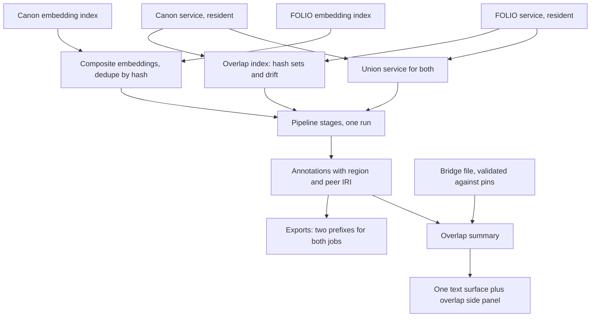

# Canon Law-and-Morals Overlap and Dense Canon Demos - Plan

## Goal Capsule

- **Objective:** Visitors, funders, and ontology people can watch any text enriched against FOLIO and the Catholic Semantic Canon together and see, per document, how much of its law, ethics, and moral vocabulary the two ontologies share. A new set of dense Canon demos shows the Canon's breadth at the same tag density as FOLIO's rich demos.
- **Product authority:** This plan owns the overlap ("both") mode, the identifier-based Venn, the moral-to-legal bridges, the overlap demos, and the dense Canon breadth demos. The divergence report for FOLIO/Canon cross-pollination is context only (see Scope Boundaries).
- **Means:** a union ontology service composed from the two resident ontologies, keyed on the shared local identifier (KTD1, KTD2).
- **Open blockers:** None.
- **Stop conditions:** stop and report if a single-ontology export changes byte-for-byte, or if the measured Venn counts against the pinned pair differ from 14,407 shared and 12 label-drifted (definition-only drift is measured and asserted separately) without a pin change.
- **Execution profile:** Deep. Ships as four PRs (backend Venn and union run, bridges, frontend, demos), grouped under Implementation Units. Implementation work goes to Codex workers. The orchestrating session verifies artifacts, reruns tests, and ships.
- **Who finishes:** the executing agent merges each PR after review and green tests and deploys to DEV (`propositions-dev.damienriehl.com`). PROD deploy is not a gate while PROD SSH stays broken.
- **Product Contract preservation:** changed: added R17–R23 — plan-time behaviors Damien confirmed at the planning synthesis (mode persistence, one tag per shared span, overlap formula, failure and no-key behavior, bridge validity, region accessibility). Document review then changed R8 (the first bridge set now names Canon-only classes that exist at the pin: usury and restitution are shared and detraction and calumny are absent), AE3 (holds without an LLM key), R23 and the self-explaining criterion (regions named by ontology, not law versus morals), and the density measure (concept annotations). Other Rs unchanged. Resolved Outstanding Questions moved into KTDs.

---

## Product Contract

### Summary

Add an "Enrich against both" mode that enriches a text once against the union of FOLIO and the Canon. It labels every tag as shared, Canon-only, or FOLIO-only, using the identifiers the two ontologies already share. A side panel shows the document's overlap percentage and curated moral-to-legal bridges. Ship 4–5 overlap demos from public-domain moral and religious texts, plus 2–3 dense Canon breadth demos, some real and some synthetic.

### Problem Frame

The Canon descends from FOLIO. Of its 14,972 labeled classes, 14,407 reuse a FOLIO local identifier under a different base IRI. About 565 classes are Canon-only, and FOLIO holds about 3,900 classes the Canon lacks. Damien leads both projects and will keep moving concepts between them. As the Canon adds faith-based concepts, the shared share of the whole will fall.

Nothing in the app shows this relationship today. Each job enriches against one ontology, no FOLIO↔Canon crosswalk exists, and the two exemplar pickers are separate. A naive demo that tags "murder" in both ontologies would only prove inheritance, and an ontology-literate funder would notice. The real moral-law link runs from Canon-native concepts such as "Commandment 07: You shall not steal." to FOLIO's legal concepts (Larceny, Fraud). No identifier joins those two sides.

The current Canon demos also look thin next to FOLIO's. They score 12–27 concept tags per 100 words, against 34–44 for FOLIO's `rich_*` demos.

### Key Decisions

- **Shared identity comes from the shared local identifier, not from labels.** Two classes that carry the same local identifier count as the same concept. Label matching would mis-map 659 Canon labels that match more than one FOLIO class, and the identifier join needs no stored table for the ~14,400 shared concepts. Governs R1, R2. (session-settled: user-directed — chosen over label-matching and a stored generated crosswalk: the Canon is a FOLIO fork with identical identifiers, and Damien will keep cross-pollinating, so the system should recognize the Venn directly and avoid duplicate work.)
- **One union run, not two runs.** The "both" mode enriches once against shared + Canon-only + FOLIO-only. That roughly halves cost and gives the text one consistent disambiguation, and it keeps FOLIO-only legal concepts that a Canon-only projection would lose. Governs R3, R4. (session-settled: user-approved — chosen over two independent runs joined by identifier and over a single Canon run projected onto FOLIO: Damien asked for whichever serves both today's high overlap and tomorrow's lower overlap; the union run stays one run as the Canon grows.)
- **Overlap means concept-level overlap, with shared vocabulary as the headline.** The headline shows how much vocabulary the two ontologies share. Curated moral-to-legal bridges form a secondary layer. Governs R6, R8. (session-settled: user-directed — chosen over leading with the moral-to-legal bridge and over presenting the ontologies as independent: shared vocabulary is itself the law-and-morals story.)
- **The headline number is per document, not global.** The global shared share will fall as the Canon grows. A theft or perjury passage keeps a high per-document score however large the Canon gets. Governs R6.
- **Layout: one reading surface with layered tags and an overlap side panel.** This is option B of the four sketched layouts. Governs R5, R6. (session-settled: user-directed — chosen over side-by-side twin panes, a three-column bridge board, and a toggle on the existing view.)
- **Live from day one.** The "both" mode runs on pasted text, not only on baked demos. Governs R3. (session-settled: user-directed — chosen over demos-only and demos-first-live-later.)
- **Bridges get model review; Damien's review is optional and never blocks.** Several cheap model passes draft and check each bridge. Governs R9, R10. (session-settled: user-directed — chosen over requiring Damien's or a CatholicOS maintainer's sign-off: limit his human work.)
- **Breadth demos aim at tag density.** Some breadth texts are real Catholic texts and some are synthetic, all at FOLIO's rich-demo density. Governs R13, R14. (session-settled: user-directed — chosen over branch-only, item-type-only, or subject-variety goals: "many tags per sentence and paragraph.")
- **Synthetic texts carry no badge.** Their description line says they are synthetic. Governs R15. (session-settled: user-directed — chosen over a visible "Synthetic" badge.)
- **Single-ontology jobs stay strict.** Today's no-cross-ontology-leakage rule keeps holding for FOLIO-only and Canon-only jobs. Only "both" jobs carry both namespaces. Governs R4, R12.

### Requirements

**Venn recognition**

- R1. The system classifies every concept in the two enabled ontologies into one region: shared (same local identifier in both), Canon-only, or FOLIO-only. It derives the regions from the pinned ontology versions, with no hand-maintained mapping for shared concepts.
- R2. A shared pair whose label or definition differs between the ontologies is marked "shared, drifted" rather than plain shared. Today 12 pairs share an identifier but differ in label.

**"Both" enrichment**

- R3. A visitor can choose "Enrich against both" for any text, live or baked. It is an opt-in choice beside today's FOLIO and Canon options, and FOLIO stays the default.
- R4. A "both" run enriches the text once against the union of the two ontologies, and each resulting tag carries its region from R1. FOLIO-only and Canon-only jobs behave exactly as they do today.
- R5. The results view shows one copy of the text, with each tagged span marked as FOLIO-only, Canon-only, or shared. Drifted pairs (R2) are visually distinguishable from plain shared tags.
- R6. A side panel shows this document's overlap: the share of tagged concepts that are shared, plus counts per region and the moral-to-legal bridges found in the text.
- R7. A shared concept's detail shows both IRIs and both branch paths, because a shared concept can sit under different parents in each ontology.

**Moral-to-legal bridges**

- R8. A curated set of bridges links Canon-only moral concepts to FOLIO legal concepts. Each bridge carries a match type (close or related) and a one-line rationale. The first set covers the Canon-only moral classes present at the pin: The Ten Commandments and Commandment 01–10, plus Justice, Restorative Justice, Natural Law, Human Law, Divine Law, Sin of Word, Sin of Deed, Personal Sin, Social Sin, and Moral Virtues, about 40–60 bridges. Usury and Criminal Restitution are already shared and render through the shared region; detraction and calumny have no Canon class yet, so R11's queue picks them up when the Canon adds them.
- R9. Several independent, cheap model passes draft and cross-check every bridge. A bridge ships only when the passes agree. Damien's review is optional and never blocks shipping.
- R10. Each bridge records how it was reviewed (model passes only, or Damien), and that status appears in the bridge's detail.
- R11. When the pinned Canon version changes, its new Canon-only concepts are queued for a model bridge pass, so the bridge set keeps pace as the Canon grows.

**Exports**

- R12. Exports of a "both" job include both IRIs for shared concepts, each tag's region, and the bridges found in the text. Exports of single-ontology jobs are unchanged.

**Demos**

- R13. Ship 4–5 overlap demos baked in "both" mode. Their texts come from public-domain sources: the Catholic Encyclopedia (1907–14), Aquinas's Summa Theologiae II-II (1920s English Dominican translation), the Decalogue and Mosaic law (Douay-Rheims), and the Baltimore Catechism. Each passage is license-verified before it is committed.
- R14. Ship 2–3 dense Canon breadth demos, some real Catholic texts and some synthetic. Each reaches at least 35 concept tags per 100 words. Together they exercise all 7 Canon roots and every enrichment item type (concepts, individuals, properties, triples).
- R15. A synthetic demo says "synthetic" in its description line, and its picker button gets no badge.
- R16. Overlap demos appear in both the FOLIO and Canon exemplar pickers under a "Law & Morals" group. Opening one, by picker or deep link, always loads it in "both" mode, whatever ontology the URL names.

**Plan-time behaviors (confirmed at planning synthesis)**

- R17. "Both" appears as a third choice in the ontology menu, and it never becomes the visitor's saved default. Opening a "both" demo, job link, or deep link leaves the saved default unchanged.
- R18. A span that both ontologies tag with the same shared concept becomes one tag carrying both IRIs, never two tags.
- R19. The overlap share counts distinct concepts, not repeated mentions, and it covers concept tags only. Drifted pairs count as shared and get their own line. A document with no concept tags shows "No concepts tagged" instead of a percentage.
- R20. When either ontology is unavailable, a "both" run refuses to start and tells the visitor why, rather than reporting a skewed overlap.
- R21. Without the visitor's LLM key, a "both" run still computes regions from the rule-based stages, and the side panel notes that the LLM stages were skipped.
- R22. A bridge counts as valid only while both of its endpoints exist and are not deprecated in the pinned ontologies, and an automated check fails on any invalid bridge.
- R23. A tag's region shows as a corner mark plus an accessible label, with a legend visible without a click that names regions by ontology ("FOLIO only", "Canon only", "In both", "In both, drifted"), so region never depends on color alone.

### Key Flows

- F1. Live overlap run
  - **Trigger:** A visitor pastes a text and chooses "Enrich against both."
  - **Steps:** The text is enriched once against the union, then the tags render on one surface by region. The side panel fills with the document's overlap share, the region counts, and any bridges. Clicking a shared tag shows both IRIs and both branch paths.
  - **Outcome:** The visitor sees how much of this text's vocabulary law and morals share.
  - **Covered by:** R3–R7
- F2. Canon update
  - **Trigger:** The pinned Canon version moves forward.
  - **Steps:** The regions are recomputed from the new pin, and drifted pairs are re-flagged. New Canon-only concepts queue for a model bridge pass. Bridges that pass agreement join the set with review status `model`.
  - **Outcome:** The Venn and bridges stay current without Damien's time.
  - **Covered by:** R1, R2, R9–R11

### Acceptance Examples

- AE1. **Covers R1, R5.** Given the text "Thou shalt not steal," when it runs in "both" mode, then "steal" or its theft concept renders as shared if the concept's local identifier exists in both ontologies, and as FOLIO-only or Canon-only otherwise.
- AE2. **Covers R2.** Given one of the 12 pairs that share an identifier but differ in label, when it is tagged, then it renders as "shared, drifted" and its detail shows both labels.
- AE3. **Covers R6, R8.** Given an Aquinas passage on theft and robbery, when it runs in "both" mode, even without an LLM key, then the side panel lists the "Commandment 07" bridge to Larceny and Fraud, along with the document's overlap share.
- AE4. **Covers R3, R8.** Given pasted text whose moral concept has no curated bridge, when it runs in "both" mode, then that concept appears as Canon-only and no bridge is invented for it.
- AE5. **Covers R4, R12.** Given a Canon-only job, when it is exported, then the export still contains no FOLIO IRIs, exactly as today.
- AE6. **Covers R16.** Given a deep link to an overlap demo with `?ontology=folio`, when the page loads, then the demo opens in "both" mode.

### Success Criteria

- **Density bar:** every new breadth demo scores at least 35 concept tags per 100 words, measured the way this plan measured the current demos: concept annotations divided by the normalized text's word count.
- **Overlap readout:** every overlap demo shows a per-document overlap share and at least one moral-to-legal bridge.
- **Self-explaining:** a first-time visitor who opens an overlap demo can tell, without a guide, which tags come from FOLIO only, which from the Canon only, and which from both ontologies; "law and morals" framing stays on the panel headline and the bridges.

### Scope Boundaries

- **Deferred:** the divergence report for cross-pollination. It would list drifted pairs, diverged definitions, Canon-native concepts FOLIO might adopt, and FOLIO additions since the fork that the Canon lacks. It grows more useful as the Canon diverges, and it would reuse R1's region computation.
- **Deferred:** publishing the bridges upstream to CatholicOS as formal mapping statements.
- **Deferred:** overlap demos from other religious or ethical traditions.
- **Deferred:** "both" mode for ontologies other than FOLIO and the Canon.
- **Not in scope:** changing FOLIO's default status, or the strictness of single-ontology jobs and exports.
- **Not in scope:** Damien's mandatory review of bridges or demo texts.
- **Not in scope:** gold-annotation (proposition) sessions on "both" jobs; the session entry point stays hidden for them.
- **Not in scope:** re-baking the existing 4 Canon demos; they stay beside the new breadth demos.
- **Considered, not built:** a third, union embedding index. Querying both existing indexes gives the same matches without ~190 MB more memory; revisit if per-query latency in "both" mode proves too slow.
- **Considered, not built:** union-mode support in the replay rebake script. Replay cannot reproduce BranchJudge or union LLM output, so "both" demos re-bake through the full bake.
- **Considered, not built:** region filter chips, a forced-colors rule, and a dual-accent theme. The glyphs, labels, and legend already meet R23; revisit after visitor feedback.
- **Considered, not built:** a persistent, pin-keyed overlap index cache. A per-process lazy build suffices while ontologies change only on restart or pin bump.
- **Considered, not built:** two independent runs joined afterward. It doubles LLM cost and lets disambiguation disagree between sides (see Key Decisions).

### Deferred to Follow-Up Work

- Fixing FOLIO-default no-argument callers that "both" mode never reaches (`owl_updater.py`, `/enrich/branches`).

### Dependencies / Assumptions

- **Identifiers keep meaning:** future cross-pollination keeps a moved concept's local identifier, so a concept shared between the projects keeps reading as shared.
- **Visitor pays live:** live "both" runs use the visitor's own LLM key under PROD's BYOK rule, like any other live run.
- **Synthetic mix:** about half the breadth demos are synthetic; planning picks the exact split against the density bar.
- **Public domain:** the listed sources are US public domain (published before 1929), and each excerpt is verified before commit (R13).

### Outstanding Questions

**Deferred to Implementation**

- Exact union branch block wording for the LLM prompts, tuned against the first overlap bake (KTD6).
- Final count of breadth demos (2 or 3) and the real/synthetic split, chosen by which texts clear the density bar (R14).

### Sources / Research

- **Current demos:** `frontend/demos/canon_samples.js`, `backend/scripts/canon_exemplars.py` (4 slugs and metadata), `backend/scripts/demo_documents.py`, and `backend/scripts/generate_demos.py` (per-ontology demo paths).
- **Single-ontology jobs:** `backend/app/api/routes/enrich.py` (the `ontology` request field), `backend/app/models/job.py`, `backend/app/config.py` (`enabled_ontologies`).
- **Deep links:** `frontend/index.html` has the separate exemplar grids (`#demoExemplars` and `#demoExemplarsCanon`) and the hard-coded `CANON_EXEMPLAR_DEMO_SLUGS`. `tryLoadDemo` takes the ontology from the URL and ignores the baked demo's own ontology, which matters for R16.
- **No-leakage rule:** AC-1 in `docs/plans/2026-07-01-002-feat-multi-ontology-catholic-canon-plan.md`.
- **Canon roots:** `docs/plans/2026-07-03-001-feat-canon-branch-roots-and-pos-salvage-plan.md` lists the 7 roots.
- **Demo freshness:** `docs/plans/2026-05-25-002-feat-prebaked-exemplar-demo-mode-plan.md` covers demo mode and freshness. The replay rebake (`backend/scripts/replay_fix_demos.py`) avoids LLM cost for deterministic fixes.
- **Measured overlap:** the Canon pin is `add8b2b1` and the FOLIO cache is dated 2026-10-30. Canon has 14,972 labeled classes and FOLIO 18,325. 14,407 share a local identifier, 12 of those differ in label, and 659 Canon labels are ambiguous in FOLIO. The Canon carries "Commandment 01"–"Commandment 10" classes that FOLIO lacks.
- **Measured density:** in concept tags per 100 words, Canon demos score nativity 12.4, rerum_novarum 12.6, trent_eucharist 13.3, and sacraments 26.6. FOLIO's `rich_*` demos score 33.9–44.2.

---

## Planning Contract

### Key Technical Decisions

- KTD1. **Regions come from `iri_hash` set membership.** `iri_hash` (`iri.rsplit("/", 1)[-1]`, already stored on `ConceptMatch`) is the shared local identifier. A hash in both ontologies' class sets is shared; drift compares the two sides' labels and definitions after each side's branch-label snapping, so spelling splits like the full and stripped "Normative" root never read as drift. The Canon's one `webprotege.stanford.edu` class cannot join and counts as Canon-only. Governs R1, R2. Implements the identifier Key Decision.
- KTD2. **"Both" is a virtual union service, not an `OntologySpec`.** `FolioService` wraps one folio-python graph, and about ten callers reach into it through `_get_folio()`. A union adapter duck-types `FolioService`'s public surface over the two resident services, borrowing them and owning no copies, so `max_resident_ontologies` LRU eviction never leaves a stray Canon copy. Raw-graph callers dispatch by IRI root to the owning side. `enabled_ids()` stays `["folio", "canon"]`; `"both"` is exposed as a separate mode. Governs R3, R4, R17. Implements the one-union-run Key Decision. Conflict call-out: research found that branch-root discovery and branch-label snapping (KTD1) key on `spec.id != default`. They stay per side, so "both" must route each concept's branch logic to its owning ontology rather than to a pseudo-id.
- KTD3. **Canon lookups use the Canon base IRI plus hash.** folio-python's `normalize_iri` turns a bare hash into a FOLIO IRI, so `canon_graph[hash]` always misses. Every Canon-side lookup composes `CANON_SPEC.base_iri + hash`. Governs R5, R7.
- KTD4. **Shared spans collapse into one annotation by hash.** The primary IRI is FOLIO's for shared and FOLIO-only concepts and the Canon's for Canon-only concepts. New optional fields on `ConceptMatch` (`region`, `peer_iri`, `peer_label`, `peer_branches`, `drifted`) default to `None` and are omitted from serialization when `None` (a wrap-mode model serializer on each touched model, since the repo serializes with plain `model_dump()`), so single-ontology JSON, SSE events, and baked demos stay byte-identical. The same rule covers the new `JobResult`/`Job` fields (`bridges`, peer base IRI). Shared object properties follow the same primary-IRI rule. Governs R4, R5, R18, AE5.
- KTD5. **Embeddings: query both existing indexes, dedupe by hash.** No third index (see Scope Boundaries). A composite embedding service answers `matches_ontology("both")` and merges per-side hits, keeping the higher score per hash. Governs R4.
- KTD6. **LLM stages run once with a union-aware prompt.** The concept prompt drops its hard-coded "FOLIO ontology branches" wording for "both" and gets an explicit union branch block listing FOLIO's curated branches and the Canon's 7 roots, cached under `"both"` in `_BRANCH_DETAIL_CACHE`. Single-ontology prompt text stays byte-identical, guarded by `TestFolioByteNeutral`. Governs R4.
- KTD7. **Bridges live in a committed data file with a validity check.** `backend/data/bridges/canon_folio_bridges.json` records each bridge's Canon hash, FOLIO hash, match type, rationale, review status, and the pins it was checked against, plus a baseline list of evaluated Canon-only hashes. A default-suite test validates every bridge against the pinned ontologies (R22); a script lists Canon-only hashes missing from the baseline after a pin bump (R11). Governs R8–R11, R22.
- KTD8. **Bridge curation runs on the agent fleet, not new API keys.** Two independent drafting passes in different model families (a Codex worker and a Claude Haiku-tier subagent) propose bridges from the pinned labels, definitions, and examples. A third pass adjudicates. A bridge ships only when both drafts agree on the FOLIO target and match type and the adjudicator accepts. Governs R9. (session-settled: user-directed — chosen over requiring Damien's or a CatholicOS maintainer's sign-off: "do multiple cheap passes with your models, so my human work is limited.")
- KTD9. **"Both" is a run mode, never persisted.** The menu entry, the `?ontology=both` URL parameter, and job hydration set the active mode for the session only. `applyOntology` and `tryLoadJob` skip the localStorage write for `"both"`. The theme keeps the FOLIO accent; the region glyphs carry the two-ontology distinction. While a "both" job or demo is on screen, the menu shows "Both" as active; switching the menu keeps today's behavior (clear results, then switch). Governs R3, R17.
- KTD10. **The frontend keys concept detail by full IRI and routes by IRI root.** `_conceptDetailCache` moves from `iri_hash` keys to full-IRI keys, and `conceptUrl` and the batch prefetch derive each request's ontology from the IRI root (`/ontologies` already returns `iri_roots`). This fixes the collision where one shared hash names two concepts. Governs R5, R7.
- KTD11. **Overlap slugs resolve to the `both` namespace before fetch.** `tryLoadDemo` maps an overlap slug to `both` through a client-side overlap slug set (mirroring `CANON_EXEMPLAR_DEMO_SLUGS`) before calling `demoUrl`, since the URL's ontology would point the fetch at the wrong folder. After the fetch it adopts the baked `job.result.ontology_id` without persisting it. The demo session-cache key gains the ontology namespace. Governs R16, AE6.
- KTD12. **Both-mode exports use two prefixes and a neutral app namespace.** JSON-LD and RDF bind `folio:` and `canon:` and mint app predicates (`hasIndividual` and similar) under a neutral enrich namespace, for "both" jobs only. The other 11 exporters already read IRIs per concept and need only the new region and peer fields. Governs R12, AE5.
- KTD13. **Dense texts are authored at bake time.** Model workers write the synthetic breadth texts, seeded with Canon labels from `get_all_labels_multi()`, and commit them to `frontend/demos/canon_samples.js`. Overlap texts go in a new `frontend/demos/overlap_samples.js` with a matching `backend/scripts/overlap_exemplars.py`, mirroring the Canon pattern. The public `/synthetic` route stays legal-only. Governs R13–R15.
- KTD14. **Bake once, after all code lands.** The overlap demos need a full LLM bake, because replay skips BranchJudge and reuses single-ontology LLM output. The Canon demos were re-baked three times when code kept landing after each bake, so the demos PR waits for the other three to merge. Governs R13, R14.

### High-Level Technical Design

The union run borrows both resident services and stamps every concept with a region before the results reach the overlap panel.

Mode behavior across the states R17, R20, and R21 govern:

| Situation | What happens |
|---|---|
| Visitor picks "Both" and submits | One union run; regions on every concept tag; default stays FOLIO for the next visit |
| Either ontology fails to load | Run refuses to start with a message naming the missing ontology |
| No visitor LLM key | Rule-based stages run; regions computed; panel notes the LLM stages were skipped |
| Overlap demo opened with `?ontology=folio` | Loads in "both" mode; saved default unchanged |
| Single-ontology job | Identical to today, byte for byte |

### Assumptions

- Real-OWL tests can read the pinned caches under `~/.folio/cache` on the dev box, marked `slow`; the default suite stays on fakes.
- The worktree has no `backend/.venv`; the executor builds one with `uv venv --python 3.13` and installs the dev extras plus `en_core_web_sm`.

### Sources

- Research dossiers (machine-local, best effort): the brainstorm grounding dossier plus planning research on repo patterns, learnings, and flow gaps. Their findings are encoded in the KTDs and units above; a missing dossier is not a blocker.
- `backend/app/services/folio/folio_service.py`, `backend/app/services/ontology/registry.py`, `backend/app/services/ontology/spec.py` — single-graph service, registry, LRU residency.
- `backend/app/services/embedding/service.py` — `matches_ontology` strict equality and per-ontology indexes.
- `backend/app/pipeline/stages/` — every stage reads `job.input.ontology`; several degrade silently on failure.
- `backend/app/services/export/jsonld_exporter.py`, `rdf_exporter.py` — single prefix and base IRI per job.
- `frontend/index.html` — `_conceptDetailCache`, `conceptUrl`, `tryLoadDemo`, `tryLoadJob`, `syncOntologyUI`, `applyOntology`, span builder, `toggleLayer`, `#panelDetail`.
- `backend/tests/test_export_ontology_neutral.py`, `test_ontology_embedding_gating.py`, `test_ontology_threading.py`, `test_ontology_registry.py` — leakage and registry guards to extend.

---

## Implementation Units

### PR1: Venn index and union "both" run

Waits on: nothing.

### U1. Ontology overlap index

**Goal:** Compute each concept's region and drift from the two pinned ontologies.

**Requirements:** R1, R2; KTD1.

**Dependencies:** none.

**Files:**
- Create `backend/app/services/ontology/overlap.py`
- Create `backend/tests/test_ontology_overlap.py`

**Approach:**
1. Build hash sets from each resident service's classes, excluding each spec's deprecated and licensing roots per `spec.behavior`.
2. For each shared hash, compare labels and definitions after branch-label canonicalization; flag drift on any difference.
3. Build the index lazily once per process from the resident services, and rebuild it when the registry resets.
4. Expose lookups by hash (region, drifted, both IRIs) and summary counts.

**Patterns to follow:** `_two_ontology_registry` and `_FakeFolio` fakes in `test_ontology_embedding_gating.py` and `test_canon_branch_label_snap.py`; per-ontology behavior via `OntologySpec.behavior`.

**Test scenarios:**
- Covers AE1. Two fake graphs sharing hash `A1` under both base IRIs → `A1` is shared; a hash only in the Canon fake is Canon-only; a hash only in FOLIO is FOLIO-only.
- Covers AE2. A shared hash whose labels differ → drifted, and both labels are returned.
- A shared hash whose labels differ only by branch-root spelling before snapping → not drifted.
- A Canon class under the `webprotege.stanford.edu` root → Canon-only.
- A deprecated class on one side → excluded from that side's set.
- Slow test against the real pinned pair → 14,407 shared hashes and 12 label-drifted pairs; the definition-only drift count is recorded and asserted (7 at review time).

**Verification:** the default suite passes on fakes, and the slow test reproduces the measured counts.

### U2. Union service and "both" request path

**Goal:** Accept `ontology: "both"` on enrichment and hand every stage a union service.

**Requirements:** R3, R4, R17, R20; KTD2, KTD3.

**Dependencies:** U1.

**Files:**
- Create `backend/app/services/ontology/union_service.py`
- Modify `backend/app/services/ontology/registry.py` (virtual `"both"` lookup that borrows residents)
- Modify `backend/app/api/routes/enrich.py` (validation accepts `"both"`; refuses with a clear 503 when either side cannot load)
- Modify `backend/app/api/routes/ontologies.py` (expose `"both"` as a mode with its display name)
- Modify `backend/app/pipeline/orchestrator.py` (`_stamp_ontology` for `"both"`: `ontology_id="both"`, both names and base IRIs)
- Modify `backend/app/models/job.py` (optional peer base-IRI field, default `None`)
- Create `backend/tests/test_union_service.py`
- Modify `backend/tests/test_ontology_registry.py`, `backend/tests/test_ontology_threading.py`

**Approach:**
1. The union adapter exposes `get_all_labels_multi`, `get_concept`, `search_by_label`, `get_all_property_labels`, `spec`, and `ontology_id`, merging both sides and attaching regions from U1.
2. `get_all_labels` (first-wins) on the union returns the shared concept once, keyed by hash.
3. Raw-graph callers get a dispatch helper that resolves an IRI root to its owning side's graph.
4. The union holds references to the registry's residents and re-fetches them on access, so eviction never strands a copy.

**Patterns to follow:** registry double-checked locking and `set_registry`/`reset_registry` hooks; `EnrichRequest._validate_ontology`.

**Test scenarios:**
- `POST /enrich` with `ontology: "both"` → accepted; the job's `ontology_id` is `"both"`.
- `enabled_ids()` still returns `["folio", "canon"]`; `/ontologies` lists `"both"` as a mode.
- Covers R20. Canon fails to load (monkeypatched `_load_folio`) → `"both"` request refused with a message naming the Canon; a FOLIO-only request still succeeds.
- Union `get_concept` on a Canon-only hash → resolves via the Canon base IRI, not FOLIO's (KTD3).
- Evicting the Canon resident, then using the union → no second Canon instance remains alive.

**Verification:** "both" jobs start and stamp correctly, and single-ontology registry tests pass unchanged.

### U3. Stage integration and annotation fields

**Goal:** Every stage consumes the union service in a "both" run and emits region-stamped annotations, one per shared span.

**Requirements:** R4, R5, R18, R21; KTD4, KTD5, KTD6.

**Dependencies:** U2.

**Files:**
- Modify `backend/app/models/annotation.py` (optional `region`, `peer_iri`, `peer_label`, `peer_branches`, `drifted`)
- Modify `backend/app/pipeline/stages/entity_ruler_stage.py`, `string_match_stage.py`, `resolution_stage.py`, `reconciliation_stage.py`, `branch_judge_stage.py`, `individual_stage.py`, `property_stage.py`, `llm_concept_stage.py`
- Modify `backend/app/services/embedding/service.py` (composite service)
- Modify `backend/app/services/concept/branch_judge.py`, `backend/app/services/property/llm_property_identifier.py`, `backend/app/services/property/property_matcher.py`
- Modify `backend/app/services/llm/prompts/concept_identification.py`, `backend/app/services/llm/prompts/templates.py`
- Modify `backend/app/services/folio/resolver.py` (per-side fork search, merged by hash)
- Create `backend/tests/test_both_mode_pipeline.py`
- Modify `backend/tests/test_ontology_embedding_gating.py`

**Approach:**
1. StringMatch and EntityRuler collapse matches by hash before creating annotations (KTD4).
2. Resolution queries the composite embedding service (KTD5); branch canonicalization and NER affinity run per concept's owning side.
3. The concept and property prompts get the union branch block (KTD6).
4. The resolver runs its raw-graph fork search once per side, using that side's graph, branch lookup, and search cache, then merges and collapses results by hash under KTD4; the union's `search_by_label` collapses shared hashes before the label resolver sees them.
5. A stage-consumption assertion records which service each stage used, so silent fallback to FOLIO fails the test.

**Execution note:** start with the stage-consumption assertion test failing, then wire stages until it passes.

**Patterns to follow:** containment-aware dedupe in `_resolve_overlaps`; deterministic `llm=None` pipeline from the NER eval harness for free end-to-end runs.

**Test scenarios:**
- Covers R18. Text "theft" with a shared hash in both fakes → exactly one annotation, `region="shared"`, FOLIO primary IRI, Canon `peer_iri`.
- A Canon-only concept → one annotation with the Canon primary IRI and no peer.
- Covers R21. `llm=None` run in "both" mode → regions present on every concept annotation.
- Every stage in a "both" run reports consuming the union service, not a FOLIO default.
- Covers AE5. A Canon-only job's result contains no `region` or `peer_*` keys and no FOLIO IRIs, matching today.
- `TestFolioByteNeutral` (`backend/tests/test_branch_detail.py`) prompt bytes are unchanged for FOLIO and Canon jobs.
- Composite embeddings: the same hash scored by both indexes → one hit with the higher score.
- A shared concept yields one resolver candidate; a Canon-only concept resolves through the per-side fork fallback.
- FOLIO and Canon `job.model_dump(mode="json")` contain none of the new keys, and `test_proposition_byte_neutral.py` passes against its existing committed fixture.

**Verification:** a deterministic "both" run over a moral-law sample produces region-stamped annotations with no duplicate shared spans, and every existing leakage test still passes.

### U4. Exports for "both" jobs

**Goal:** Both-mode exports carry both IRIs, regions, and two namespaces.

**Requirements:** R12; KTD12.

**Dependencies:** U3.

**Files:**
- Modify `backend/app/services/export/jsonld_exporter.py`, `rdf_exporter.py`, and the exporters that serialize concept fields
- Modify `backend/tests/test_export_ontology_neutral.py`

**Approach:** branch on `ontology_id == "both"` for prefixes and the app namespace; emit `region` and `peer_*` where the exporter already writes concept fields.

**Test scenarios:**
- Every format for a "both" fixture contains both base IRIs and a region per concept.
- JSON-LD context binds `folio:` and `canon:`; RDF app predicates sit in the neutral namespace.
- Covers AE5. Existing Canon and FOLIO export assertions pass unchanged, byte for byte.

**Verification:** all export formats run on a "both" fixture, and single-ontology outputs are unchanged.

### PR2: Moral-to-legal bridges

Waits on: PR1 (merge order only; builds on PR1's annotation fields).

### U5. Bridge data, validity check, and curation

**Goal:** Ship the first curated bridge set and attach the bridges found in each "both" result.

**Requirements:** R8, R9, R10, R11, R22; KTD7, KTD8.

**Dependencies:** U3.

**Files:**
- Create `backend/data/bridges/canon_folio_bridges.json`
- Create `backend/app/services/ontology/bridges.py`
- Create `backend/scripts/bridge_queue.py`
- Modify `backend/app/models/job.py` (optional `bridges` list on results, default `None`)
- Modify `backend/app/pipeline/stages/metadata_stage.py` to attach bridges, for `ontology_id == "both"` results only
- Modify every exporter that serializes results to include result bridges
- Create `backend/tests/test_bridges.py`

**Approach:**
1. Curate the first set (Ten Commandments plus usury, detraction, calumny, and restitution) through the KTD8 passes; record match type, rationale, review status, and pins.
2. Record every Canon-only hash at the current pin as the evaluated baseline.
3. Attach a bridge to a "both" result when either its Canon endpoint or its FOLIO endpoint appears among the annotations, recording which endpoint matched.

**Test scenarios:**
- Covers R22. A bridge whose FOLIO endpoint is missing from the pinned FOLIO → validation fails naming the bridge.
- A bridge whose endpoint is deprecated → validation fails.
- Covers AE3. A "both" result containing the Commandment 07 concept → result bridges include Commandment 07 → Larceny and Fraud.
- Covers AE4. A tagged Canon-only concept with no bridge → no bridge attached, none invented.
- `bridge_queue.py` on a fake pin with one new Canon-only hash → lists that hash only.
- Every bridge's review status is `model` or `damien`.
- A Canon-only job's result carries no bridges and no FOLIO IRIs.
- Covers AE3. A deterministic (`llm=None`) "both" run over a real Aquinas II-II q.66 excerpt attaches the Commandment 07 bridge through its FOLIO endpoint.
- A bridge whose Canon endpoint has become shared (adopted into FOLIO under the same identifier) fails validation as no longer Canon-only.
- Every export format for a "both" fixture with bridges includes them.

**Verification:** the bridge file validates against the real pins (slow test), holds 40–60 bridges, and attaches correctly in a deterministic "both" run.

### PR3: Frontend "both" mode

Waits on: PR1 (merge order only); PR2 (merge order only; the panel renders bridges when present).

### U6. Both-mode results view

**Goal:** One text surface with region-marked tags, an overlap side panel, and dual concept detail.

**Requirements:** R2, R3, R5, R6, R7, R10, R17, R19, R21, R23, AE2; KTD9, KTD10.

**Dependencies:** U3, U5.

**Files:**
- Modify `frontend/index.html`

**Approach:**
1. Add "Both" to the ontology menu from `/ontologies` modes; never persist it (KTD9); add the dual-accent theme.
2. Re-key `_conceptDetailCache` by full IRI and route `conceptUrl` and the batch prefetch by IRI root (KTD10).
3. Mark region on concept tags only with one distinct glyph per region (shared, Canon-only, FOLIO-only, plus a drifted modifier) at the span's top-right corner, outside the border and background channels; on nested spans only the innermost tag shows a glyph, and its `aria-label` lists the regions present. Add the legend (R23) with a note that overlap covers concept tags; individuals, properties, and triples render as today.
4. Add the overlap panel as a section at the top of the right panel, visible only in "both" mode; below the 700px breakpoint it collapses to a one-line summary (share and counts) above the text that expands on tap. It holds the distinct-concept share, region counts, drifted line, bridges, the "No concepts tagged" state, and the skipped-LLM note directly under the share. Each bridge row shows the Canon label, FOLIO target labels, match type, and review status (R10), and says "not in this text" for an endpoint absent from the text; clicking a row highlights the matching spans and opens the Canon concept, with its rationale, in the detail panel.
5. Show both IRIs and both branch paths in `#panelDetail` for shared tags, and both labels for drifted pairs.
6. Hide the gold-annotation session entry point on "both" jobs.

**Patterns to follow:** `toggleLayer` chips, the existing span builder channels, `fallbackDetailFromBaked`, layout B from the brainstorm sketch.

**Test scenarios:**
- Test expectation: no JS unit harness exists; verification is a Playwright run (below) plus backend tests for the data the panel reads.
- Playwright: a "both" fixture renders shared, Canon-only, and FOLIO-only spans, each with a distinct corner glyph and `aria-label` naming its region.
- Playwright: clicking a shared tag shows two IRIs and two branch paths, fetched from the correct ontology each.
- Playwright: after a "both" run, reloading without parameters returns to the saved default (FOLIO).
- Playwright: a zero-tag fixture shows "No concepts tagged".
- Playwright: the overlap share equals distinct shared concepts divided by distinct tagged concepts for the fixture.
- Covers AE2. Playwright: a drifted fixture shows the drifted glyph, its legend entry, and both labels in detail.
- Playwright: a nested shared-inside-Canon-only pair shows one glyph whose `aria-label` names both regions.
- Playwright: clicking a bridge row highlights its span and opens the Canon concept with rationale and review status.

**Verification:** screenshots at desktop and phone widths in light and dark themes show the layout, legend, and panel, and an inspected screenshot confirms each Playwright scenario.

### U7. Demo loading rules and Law & Morals group

**Goal:** Overlap demos open in "both" mode from any entry point.

**Requirements:** R16, AE6; KTD11.

**Dependencies:** U6.

**Files:**
- Modify `frontend/index.html`

**Approach:** add a "Law & Morals" group and an overlap slug set to both exemplar grids; `tryLoadDemo` resolves overlap slugs to the `both` namespace before fetching, then adopts the baked `ontology_id` (KTD11); namespace the demo session-cache key by ontology.

**Test scenarios:**
- Covers AE6. Playwright: `?demo=<overlap slug>&ontology=folio` opens in "both" mode and the saved default stays FOLIO.
- Playwright: a FOLIO slug and an overlap slug with the same name do not collide in session cache.
- Playwright: the Law & Morals group appears in both the FOLIO and Canon pickers.

**Verification:** each entry point (picker, deep link, ontology switch) lands on the demo in "both" mode.

### PR4: Demos

Waits on: PR1, PR2, PR3 (needed before start: the bake runs against the merged code, per KTD14).

### U8. Bake pipeline support

**Goal:** The bake, slim, and seed tooling handle the `both` namespace and new sample modules.

**Requirements:** R13, R14; KTD13, KTD14.

**Dependencies:** U3, U5.

**Files:**
- Create `frontend/demos/overlap_samples.js`, `backend/scripts/overlap_exemplars.py`
- Modify `backend/scripts/demo_documents.py`, `generate_demos.py` (composite `.owl-version` sidecar and samples hash), `slim_demos.py` (recursive glob)
- Create `backend/tests/test_demo_density.py`
- Modify `backend/tests/test_demo_freshness.py`

**Approach:** mirror `canon_exemplars.py` for overlap texts; warm both ontologies in `init_services` for "both"; demos write to `frontend/demos/both/`.

**Test scenarios:**
- `load_demo_documents("both")` returns the overlap slugs with metadata.
- Sidecar for "both" records the FOLIO content hash and the Canon pin.
- Density test on baked Canon breadth demos → each at least 35 concept tags per 100 words, measured as annotations divided by normalized-text word count.
- Each baked overlap demo shows a nonzero shared share and at least one bridge.
- `demo_seed` loads `frontend/demos/both/*.json` and each validates as a `Job`.

**Verification:** a no-LLM dry bake writes valid files in the `both` namespace, and the freshness and density tests run.

### U9. Author texts, curate, and bake

**Goal:** Ship 4–5 overlap demos and 2–3 dense breadth demos.

**Requirements:** R13, R14, R15; Success Criteria.

**Dependencies:** U7, U8.

**Files:**
- Modify `frontend/demos/overlap_samples.js`, `frontend/demos/canon_samples.js`, `backend/scripts/canon_exemplars.py`
- Create `frontend/demos/both/*.json`, new `frontend/demos/canon/*.json`

**Approach:**
1. Pick excerpts from the four sources and record each one's publication date and edition for the public-domain check.
2. Model workers author synthetic breadth texts seeded with Canon labels; synthetic descriptions say "synthetic".
3. Bake once with an explicit API key; rewrite any breadth text that misses the density bar, then re-bake only that slug.

**Test scenarios:**
- Test expectation: content unit; U8's density and overlap tests gate it.

**Verification:** density and overlap tests pass on the committed demos, and Playwright screenshots of each overlap demo show the panel with a share and at least one bridge.

---

## Verification Contract

| Gate | Command or check | Applies to |
|---|---|---|
| Default suite | `cd backend && .venv/bin/python -m pytest tests/ -v` | every PR |
| Real-ontology checks | same command with `-m slow` | U1, U5 |
| Demo checks | same command with `-m demo_regen` | U8, U9 |
| Byte-neutral guards | existing assertions in `test_export_ontology_neutral.py`, `TestFolioByteNeutral`, and `test_proposition_byte_neutral.py` (with its committed fixture) unchanged and green; U4 adds "both" cases alongside | PR1, PR2 |
| Browser UAT | Playwright scenarios in U6 and U7 against a local server on port 8731, with inspected screenshots | PR3, PR4 |
| DEV smoke | open an overlap demo and run a live "both" job on DEV | after PR4 deploy |

## Definition of Done

- All R1–R23 are true and every AE has a passing check.
- Single-ontology job results and exports are byte-identical to before for the baked FOLIO and Canon fixtures.
- Every bridge validates against the pinned ontologies, and the evaluated baseline is committed.
- Each new breadth demo meets the density bar; each overlap demo shows a share and a bridge.
- DEV serves the overlap demos and a live "both" run.
- Code from abandoned approaches is removed from the diff, and background servers and browsers started for UAT are stopped.
